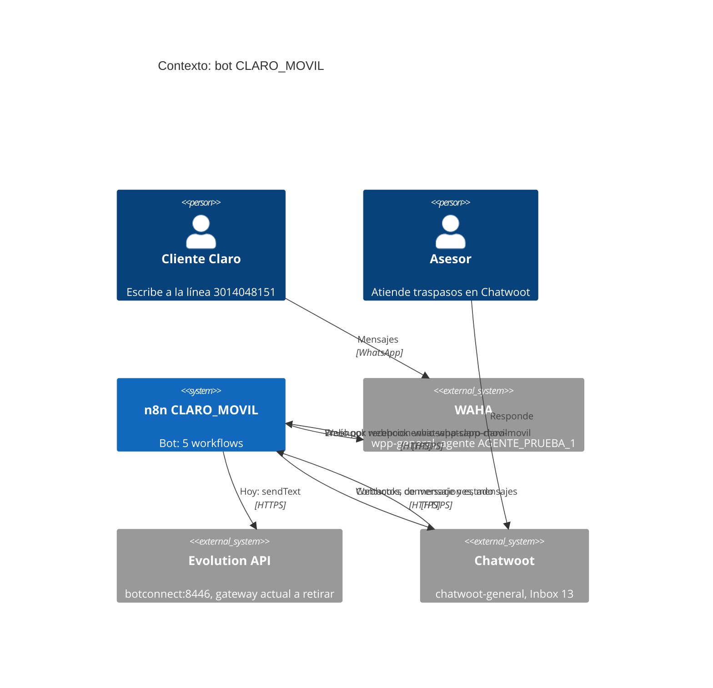
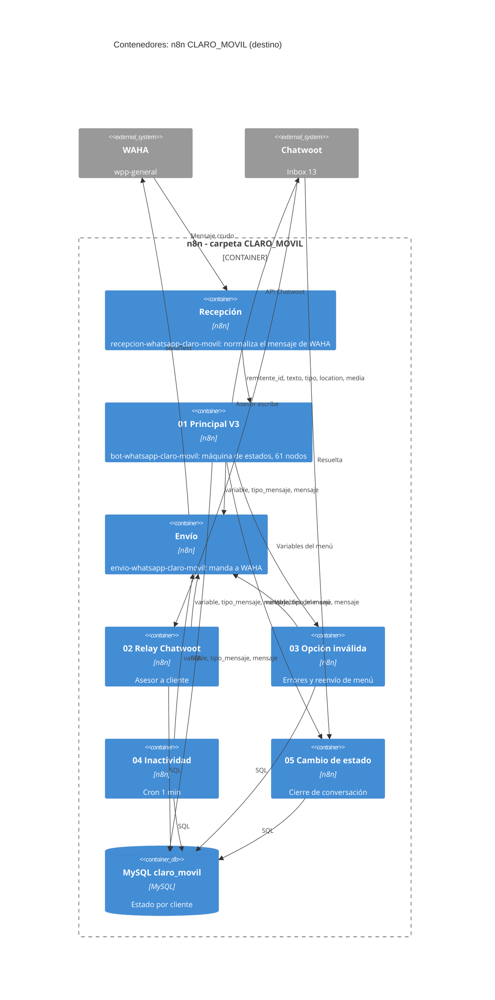
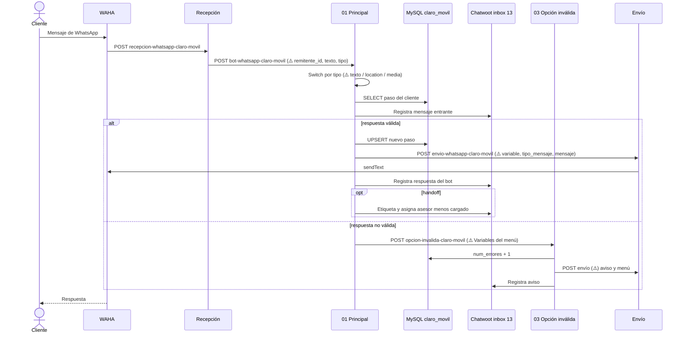
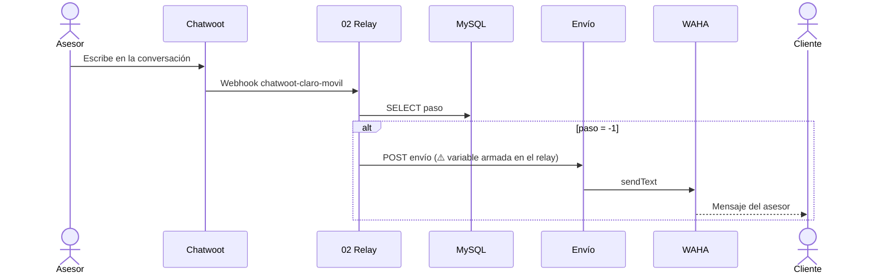

# Pitch: Migración del bot CLARO_MOVIL de Evolution a WAHA

> Basado en [Shape Up, capítulo 6: Write the pitch](https://basecamp.com/shapeup/1.5-chapter-06). Plantilla: [Plantilla de Pitch](../Templates/Plantilla-Pitch.md).

**Solicitado por:** [Mónica](../People/Monica.md) (asigna la línea). Línea sincronizada en WAHA por [Sergio](../People/Sergio.md).
**Proyecto:** [Migración WAHA: CLARO_MOVIL](../Projects/Migracion-WAHA-CLARO_MOVIL.md)
**Fecha:** 2026-10-23
**Estado:** borrador

Fuentes: [Contexto de la tarea](../Projects/Contexto-Migracion-WAHA-CLARO_MOVIL.md) · [Documentación de n8n](../n8n/Documentacion%20de%20n8n.md) · [Comparación TODO_CLARO vs CLARO_MOVIL](../n8n/Comparacion%20TODO_CLARO%20vs%20CLARO_MOVIL.md) · [Flujo modelo TODO_CLARO (canvas)](../n8n/TODO_CLARO/TODO-CLARO-Principal.canvas).

---

## Datos de la línea (fila 25 del inventario de líneas de WhatsApp)
| Columna del Excel | Valor |
|---|---|
| Línea WhatsApp | 3014048151 |
| Campaña | CLARO_MOVIL |
| Propietario | ICC |
| Tipo (Verificada / No verificada) | No verificada |
| Estado | En migración Waha |
| Responsable | Sergio Moreno (desarrollo) |
| Fecha inicio Producción / Fecha bloqueo | (vacías) |
| Servidor (Evolution) | [`https://botconnect.interactivo.com.co:8446/manager`](https://botconnect.interactivo.com.co:8446/manager), carpeta CLARO_MOVIL |
| Agente Evolution | AGENTE_PRUEBA_1 |
| Agente WAHA | AGENTE_PRUEBA_1 |
| Chatwoot | Inbox 13 - CLARO_MOVIL |
| URL Chatwoot | [`https://chatwoot-general.interactivo.com.co/`](https://chatwoot-general.interactivo.com.co/) |
| Etiqueta / Carga base / Observación | (vacías) |

**Webhook que dejó Sergio en WAHA:** `https://n8n-general.interactivo.com.co/webhook/recepcion-whatsapp-claro-movil`
**WAHA (URL base según el flujo modelo):** `https://wpp-general.interactivo.com.co`
**Accesos y claves:** en el Excel de inventario (no se copian aquí).

## 0. Preguntas obligatorias al iniciar
- [x] **Persistencia:** no aplica. Todo queda dentro de n8n (estado en la tabla `claro_movil`, conversaciones en Chatwoot). La migración no cambia dónde se guarda nada.
- [x] **Código analítico:** no aplica. No usan la API de WhatsApp sino Chatwoot y webhooks; ya existen flujos de conexión que este flujo reutiliza. No se tocan tablas.

## 1. Problema
La línea **CLARO_MOVIL (3014048151)** atiende hoy por Evolution API. Está marcada "En migración Waha". Sergio ya la sincronizó en WAHA (agente `AGENTE_PRUEBA_1`) y apuntó el webhook a n8n, pero los 5 workflows de la carpeta CLARO_MOVIL siguen hechos para Evolution.

- **Situación actual:**
  - El Principal escucha en `/webhook/bot-claro-movil` y lee el payload crudo de Evolution (`body.data.key.remoteJid`, `body.data.message.conversation`, `locationMessage`).
  - Los 12 nodos de envío llaman a `POST {url_evolution}/message/sendText/{session}` con `apikey`.
  - Las variables `url_evolution`, `api_evolution` y `session` están repetidas en 6 nodos Set, y Chatwoot apunta a `botconnect…:8443`.
  - El flujo ya migrado de otra campaña (**TODO_CLARO Principal V 3.0**) usa otro patrón: recibe un cuerpo ya normalizado y envía por un webhook intermedio.
- **Quién lo sufre y con qué frecuencia:** cada cliente que escribe a la línea (planes, portabilidad, migración) y los asesores que reciben el traspaso en el inbox 13 de Chatwoot. Cada mensaje.
- **Qué pasa si no se hace:** la línea queda sin migrar y el bot deja de atender cuando se corte Evolution.

## 2. Appetite
Definido por Vic: **Medium (1 semana).**

- [ ] Small batch (1-2 días)
- [x] Medium (1 semana)
- [ ] Big batch (2-6 semanas)

Los cambios son mecánicos y hay un flujo modelo ya migrado; lo que más tiempo puede tomar es validar con mensajes reales.

## 3. Solución
Llevar los workflows de CLARO_MOVIL al mismo patrón del flujo modelo TODO_CLARO, sin cambiar la lógica del menú, Chatwoot ni MySQL. **Los cambios en n8n los hace Vic**; los JSON de `n8n-json/` solo documentan.

### 3.1 Elementos clave
**Fijo (hay que hacerlo):**
1. **Entrada del Principal.** Escuchar en `bot-whatsapp-claro-movil` y leer el cuerpo normalizado que entrega la recepción (`recepcion-whatsapp-claro-movil`):
   - Teléfono: `body.data.key.remoteJid.split('@')[0]` → `body.remitente_id`.
   - Texto: `body.data.message.conversation` / `extendedTextMessage.text` → `body.texto`.
   - Tipo: Switch por `body.tipo` (`location`, `texto`, `audioMessage`, `media`) en lugar de deducirlo de la forma del objeto.
   - Ubicación: `locationMessage.degreesLatitude/Longitude` → `body.location.latitude/longitude/live`.
   - Imagen: nueva rama que descarga `body.media.url` de WAHA (`X-Api-Key`) y la sube a Chatwoot como adjunto.
2. **Envío (12 nodos `sendText`).** Principal (3), Relay (1), Opción inválida (7), Inactividad (1). Cada uno pasa a:
   `POST https://n8n-general.interactivo.com.co/webhook/envio-whatsapp-claro-movil`
   ```json
   { "variable": <Variables del menú>, "tipo_mensaje": "texto", "mensaje": "<texto>" }
   ```
3. **Variables.** Quitar `url_evolution`, `api_evolution` y `session`; poner `integracion: "WAHA"`, `url_wp` (`https://wpp-general.interactivo.com.co`), `api_wp` (clave del Excel), `session_wp` (`AGENTE_PRUEBA_1`), `payload`, `url_chatwoot` (`chatwoot-general`) e `inbox_id` (`13`). Aplica a Variables del menú, Variables ubicacion y Variables globales (Principal), Variables (Relay) y Variables (Inactividad).
4. **Sub-flujos.** `Llamar opción inválida` y `Validacion error1` mandan `Variables del menú` completo como body; Opción inválida, Inactividad, Relay y Cambio de estado leen de ahí (el cliente sale de `payload.remitente_id`).

**Flexible (a criterio de Vic):**
- Si se agrega el log de interacción como en el modelo.
- Si se filtran grupos o mensajes sin texto en el Principal.
- Si se mueven las claves a credenciales de n8n.

**Sin tocar:** el flujo 05 Cambio de estado (no envía a WhatsApp), los nodos de Chatwoot y MySQL, la lógica del menú y los textos, el geocodificado Nominatim y el cron de Inactividad (salvo su envío).

### 3.2 Contexto (C4, nivel 1 y 2)




### 3.3 Flujo (diagrama de secuencia)
Un mensaje del cliente con el patrón nuevo (⚠️ = lo que cambia en CLARO_MOVIL):


Con asesor (`paso = -1`):


### 3.4 Mockup
No aplica: no hay interfaz gráfica.

## 4. Rabbit holes
- **Ruta de reenvío de la recepción.** El Principal debe escuchar donde la recepción reenvía. *Decisión:* revisar en n8n a qué path apunta `recepcion-whatsapp-claro-movil` antes de nombrar el webhook del Principal (por el patrón del modelo: `bot-whatsapp-claro-movil`).
- **Contrato de `variable`.** El Relay lo dispara Chatwoot, no WAHA, así que debe armar `variable` a mano (`url_wp`, `api_wp`, `session_wp`, `payload.remitente_id` = `contact_inbox.source_id`). *Decisión:* copiar la forma de `Variables del menú` del modelo.
- **Sub-flujos que leen el body.** Opción inválida hoy lee `body.cliente`, `body.session`, `body.url_evolution`… y pasaría a leer `body.payload.remitente_id`, `body.session_wp`, `body.url_wp`. *Decisión:* cambiar Principal y sub-flujos a la vez.
- **No copiar los defectos del modelo.**
  - Hay 8 nodos huérfanos de Evolution.
  - `If2` lee `body.data.key.fromMe`.
  - Los UPDATE usan `Variables del menú.session`, que ese nodo no define.
  - Dos nodos siguen en `botconnect:8443`.
  - Hay claves escritas en los nodos.
  - La salida de audio no va a ningún nodo.
  *Decisión:* usar el modelo como guía de patrón, no de código; detalle en la [comparación](../n8n/Comparacion%20TODO_CLARO%20vs%20CLARO_MOVIL.md).
- **Ubicación en vivo.** El modelo trae `location.live`. *Decisión:* validar con un mensaje real.
- **Respuestas duplicadas.** Si Evolution y WAHA atienden la línea a la vez. *Decisión:* un solo proveedor activo durante las pruebas.
- **Rutas de los workflows originales.** Los de Evolution comparten paths con las copias. *Decisión:* paths con sufijo en la copia hasta el corte (ver la [guía de pruebas](../n8n/Guia%20de%20pruebas%20CLARO_MOVIL.md)).
- **Claves en claro en los nodos Set.** Al poner `api_wp`, no repetir la práctica si se puede usar credenciales de n8n.
- **Antibloqueo.** El bot responde de inmediato y el cron de Inactividad envía en lote. Se vigila, no se resuelve en este alcance.

## 5. No-gos
- No se cambia la lógica del menú, los textos, los pasos ni las etiquetas.
- No se tocan tablas, código analítico ni Chatwoot; el flujo 05 solo cambia lo que recibe.
- No se migra historial de Evolution.
- No se migran otras líneas del inventario (solo la fila 25).
- No se refactoriza el Principal ni se rediseña el manejo de credenciales.
- No se borran los workflows de Evolution: se desactivan y se dejan como respaldo.

## 6. Preguntas abiertas
1. ¿A qué path reenvía hoy `recepcion-whatsapp-claro-movil`? (se ve en n8n)
2. ¿Cuál es la clave `api_wp` de WAHA para esta línea? (Excel de inventario)
3. ¿Cuándo es la ventana de corte y quién valida las pruebas? (Mónica / Sergio)

## 7. Definición de terminado (de las reglas operativas)
Funcionando en test, evidencia subida en la tarea, evidencia en Sonar si aplica, tareas liberadas. Pruebas mínimas: bienvenida, cada opción del menú, opción inválida ×3 con cierre, inactividad (recordatorio 1, 2 y cierre), handoff con asesor y respuesta del asesor al cliente, ubicación válida e inválida, imagen.

---
Volver a [Home](../Home.md) · [Pitches](Pitches.md)
