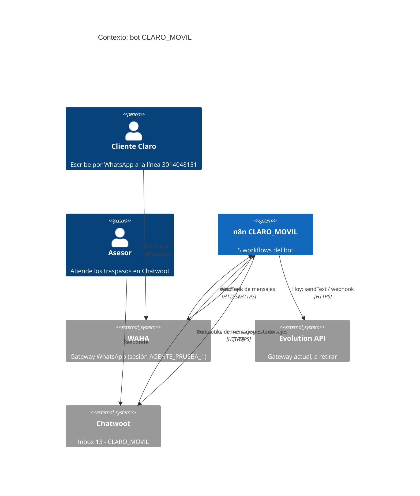
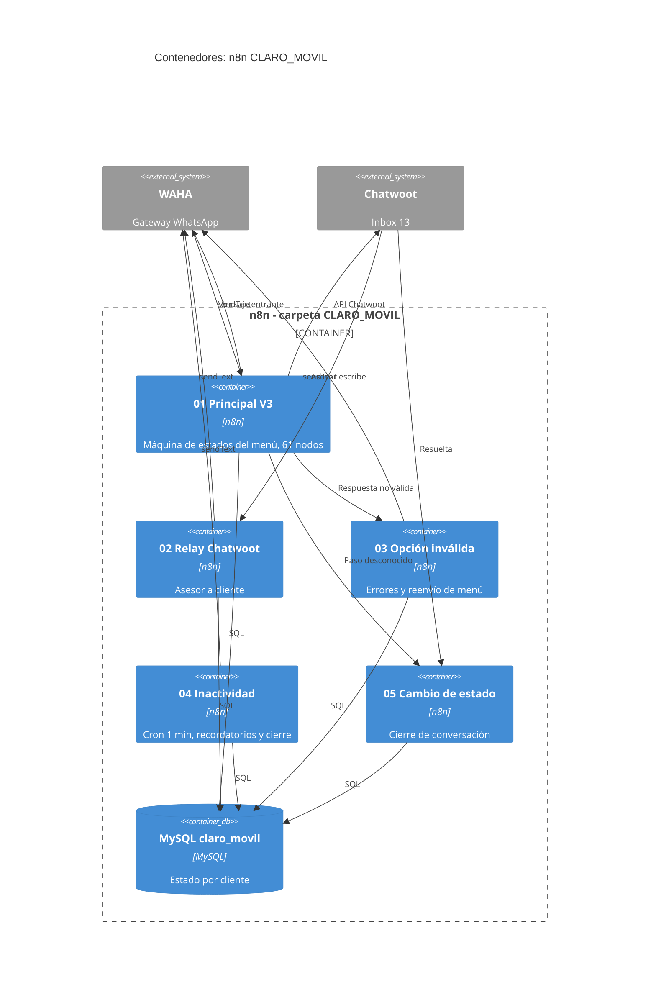
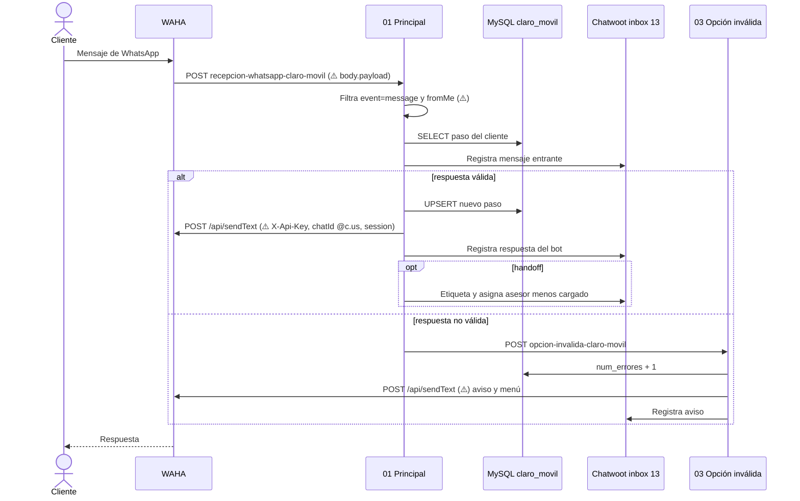
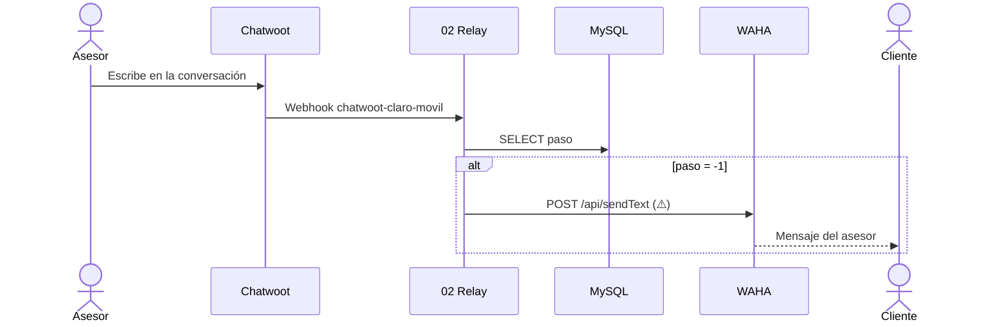

# Pitch: Migración del bot CLARO_MOVIL de Evolution a WAHA

> Basado en [Shape Up, capítulo 6: Write the pitch](https://basecamp.com/shapeup/1.5-chapter-06). Plantilla: [Plantilla de Pitch](../Templates/Plantilla-Pitch.md).

**Solicitado por:** [Mónica](../People/Monica.md) (asigna). Línea sincronizada en WAHA por [Sergio](../People/Sergio.md).
**Proyecto:** [Migración WAHA: CLARO_MOVIL](../Projects/Migracion-WAHA-CLARO_MOVIL.md)
**Fecha:** 2026-10-21
**Estado:** borrador

Fuentes: [Contexto de la tarea](../Projects/Contexto-Migracion-WAHA-CLARO_MOVIL.md) · [Documentación de n8n](../n8n/Documentacion%20de%20n8n.md) · [Guía Evolution → WAHA](../Wiki/Migracion-Evolution-a-WAHA.md).

---

## 0. Preguntas obligatorias al iniciar
- [x] **Persistencia:** no aplica. Todo queda dentro de n8n (estado en la tabla MySQL `claro_movil`, conversaciones en Chatwoot). La migración no cambia dónde se guarda nada. Lo que sí hay que cuidar: la columna `session_wpp` guarda la sesión con la que se atiende al cliente, y hoy vale `AGENTE_PRUEBA_1`.
- [x] **Código analítico:** no aplica. Usan Chatwoot y webhooks, no la API de WhatsApp; los flujos de conexión ya existen y este flujo los reutiliza.

## 1. Problema
La línea **CLARO_MOVIL (3014048151)** funciona hoy con Evolution API. La empresa está pasando sus líneas a WAHA ("En migración Waha", fila 25 del inventario). Sergio ya sincronizó la línea en WAHA (sesión/agente `AGENTE_PRUEBA_1`) y dejó el webhook apuntando a n8n, pero los 5 workflows de n8n siguen hablando el "idioma" de Evolution: otro formato de mensaje entrante, otra URL y header de envío, otro cuerpo de envío.

- **Situación actual:** WAHA entrega los mensajes a `…/webhook/recepcion-whatsapp-claro-movil`, pero el flujo Principal escucha en `…/webhook/bot-claro-movil` y lee `body.data.key.remoteJid` / `body.data.message.conversation`. Los 12 nodos de envío llaman a `/message/sendText/{session}` con `apikey`. Con WAHA, el bot no recibiría ni respondería correctamente.
- **Quién lo sufre y con qué frecuencia:** cada cliente que escribe a la línea de Claro Móvil (venta de planes, portabilidad, migración), y los asesores que reciben el traspaso en Chatwoot inbox 13. Cada mensaje.
- **Qué pasa si no se hace:** la línea queda sin migrar, y el bot dejaría de atender al cortar Evolution.

## 2. Appetite
Mónica y Sergio no definieron plazo ni tamaño. **Por definir** (pregunta abierta 1).

- [ ] Small batch (1-2 días)
- [x] Medium (1 semana)
- [ ] Big batch (2-6 semanas)

Referencia para decidir: son 4 workflows con cambios y 1 sin cambios; los cambios son mecánicos (ver 3.1), lo que más tiempo puede tomar es validar con un payload real de WAHA.

## 3. Solución
Adaptar los workflows existentes de n8n para que reciban y envíen por WAHA, sin cambiar la lógica del menú, Chatwoot ni MySQL. **Los cambios en n8n los hace Vic**; los JSON de `n8n-json/` solo documentan.

### 3.1 Elementos clave
**Fijo (hay que hacerlo):**
1. **Recepción (flujo 01 Principal):** pasar de `body.data…` a `body.payload…`.
   - Teléfono: `data.key.remoteJid` → `payload.from` (se sigue haciendo `split('@')[0]`).
   - Texto: `data.message.conversation` / `extendedTextMessage.text` → `payload.body`.
   - Mensaje propio: `data.key.fromMe` → `payload.fromMe`, más filtrar `event = message`.
   - Ubicación: `locationMessage` / `degreesLatitude` → `payload.location` (`latitude`, `longitude`).
   - Son unos 20 nodos de Principal que leen el payload (ver la tabla de intervención).
2. **Envío (12 nodos `sendText`):** Principal (3), Relay (1), Opción inválida (7), Inactividad (1).
   - URL `/message/sendText/{session}` → `/api/sendText`.
   - Header `apikey` → `X-Api-Key`.
   - Body `number` → `chatId` (`número@c.us`) y `session` dentro del body.
3. **Variables:** `url_evolution` / `api_evolution` → URL y clave de WAHA, en los nodos Set de Principal (Variables del menú, Variables ubicacion), Relay (Variables) e Inactividad (Variables). Principal las pasa por el body a Opción inválida: se cambia en ambos lados a la vez.
4. **Webhook de entrada:** igualar la ruta de Principal con la que Sergio dejó en WAHA (`recepcion-whatsapp-claro-movil`).

**Flexible (a criterio de Vic/Sergio):**
- Si se renombra la ruta del Principal o se deja la actual y se cambia el webhook de WAHA.
- Si se añade un nodo normalizador al inicio de Principal o se cambia cada expresión.
- Si se añaden filtros de grupo (`@g.us`) o `startTyping/stopTyping`.

**Sin tocar:** 05 Cambio de estado (no usa Evolution), todos los nodos de Chatwoot y MySQL salvo los que leen el teléfono del payload, la lógica del menú, el geocodificado Nominatim y el cron de inactividad (salvo su `sendText`).

### 3.2 Contexto (C4, nivel 1 y 2)

### 3.3 Flujo (diagrama de secuencia)
Camino de un mensaje con WAHA, marcando lo que cambia (⚠️):

Con asesor (`paso = -1`):

### 3.4 Mockup
No aplica: no hay interfaz gráfica.

## 4. Rabbit holes
- **Formato real del payload de WAHA** → no hay uno capturado. `payload.from`, `payload.body` y `payload.location` están tomados de la documentación. *Decisión:* capturar un mensaje real (texto y ubicación) en el webhook antes de cambiar las expresiones.
- **`payload.from` puede venir como `@lid` según el motor** (NOWEB/GOWS) en vez de `@c.us` → el teléfono guardado en `claro_movil.cliente` ya no coincidiría. *Decisión:* confirmar el motor de la sesión y probar con un número real.
- **Ubicación en vivo**: Evolution distingue `liveLocationMessage` y su secuencia; en WAHA la estructura puede ser distinta. *Decisión:* validar; si no llega la ubicación en vivo, documentarlo como limitación.
- **Doble ruta de webhook** (`bot-claro-movil` vs `recepcion-whatsapp-claro-movil`) → mensajes que no llegan. *Decisión:* igualar antes de probar.
- **Dos dominios de n8n** (`2031510-n8n…` en los flujos, `n8n-general…` en WAHA) → los sub-flujos se llaman por la URL de `url_n8n`. *Decisión:* confirmar cuál es el vigente.
- **Dos URLs de Chatwoot** (`botconnect…:8443` en los flujos, `chatwoot-general…` en el Excel) → *Decisión:* confirmar; no se cambia nada hasta saberlo.
- **Respuestas duplicadas**: si Evolution y WAHA atienden la misma línea al tiempo. *Decisión:* un solo proveedor activo por línea durante las pruebas.
- **Sesión `AGENTE_PRUEBA_1`**: nombre de prueba usado como `session` y guardado en `session_wpp`. *Decisión:* confirmar con Sergio que es el definitivo.
- **Claves en claro en los nodos Set** (Chatwoot y Evolution): al reemplazar las de Evolution por las de WAHA, no repetir la mala práctica si se puede usar credenciales de n8n.
- **Antibloqueo**: el bot responde de inmediato y el cron de inactividad envía en lote. Se vigila, no se resuelve en este alcance.

## 5. No-gos
- No se cambia la lógica del menú, los textos, los pasos ni las etiquetas.
- No se toca el flujo 05 Cambio de estado, Chatwoot ni la estructura de MySQL.
- No se migra historial de Evolution (WAHA no lo importa y aquí no se necesita: el estado vive en `claro_movil`).
- No se migran otras líneas del inventario (solo la fila 25).
- No se rediseña el manejo de credenciales ni se refactoriza el flujo Principal.
- No se borran los workflows de Evolution: se desactivan y se dejan como respaldo.

## 6. Preguntas abiertas
1. ¿Cuál es el appetite / fecha esperada de Mónica?
2. ¿Qué ruta queda para el Principal: `bot-claro-movil` o `recepcion-whatsapp-claro-movil`?
3. ¿`AGENTE_PRUEBA_1` es la sesión definitiva?
4. ¿Qué motor usa la sesión de WAHA (NOWEB / GOWS / WEBJS)?
5. ¿Cuál es el dominio de n8n y la URL de Chatwoot vigentes?
6. ¿Dónde están la URL y la clave de WAHA (Excel de inventario)? Los workflows las necesitan en los nodos Set.
7. ¿Quién valida las pruebas y cómo se corta Evolution (ventana, aviso por Teams)?

## 7. Definición de terminado (de las reglas operativas)
Funcionando en test, evidencia subida en la tarea, evidencia en Sonar si aplica, tareas liberadas. Pruebas mínimas: bienvenida, cada opción del menú, opción inválida ×3 con cierre, inactividad (recordatorio 1, 2 y cierre), handoff con asesor y respuesta del asesor al cliente, ubicación válida e inválida.

---
Volver a [Home](../Home.md) · [Pitches](Pitches.md)
