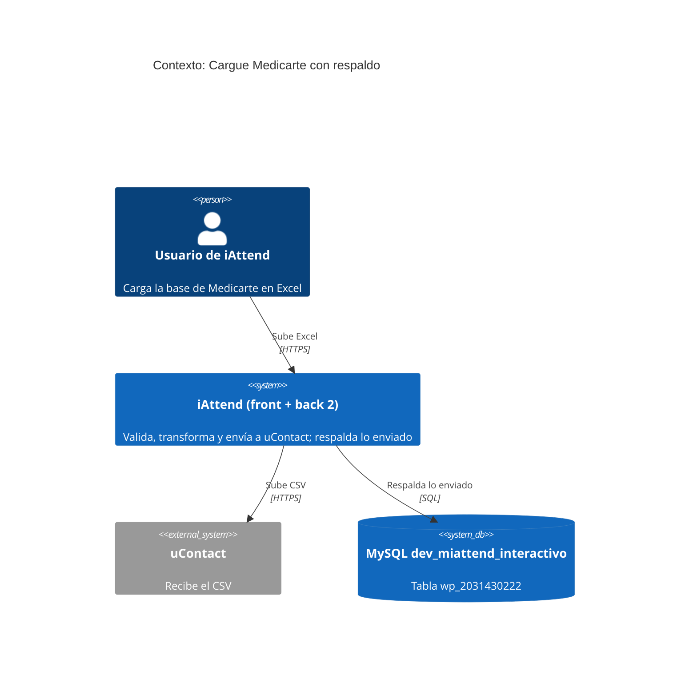
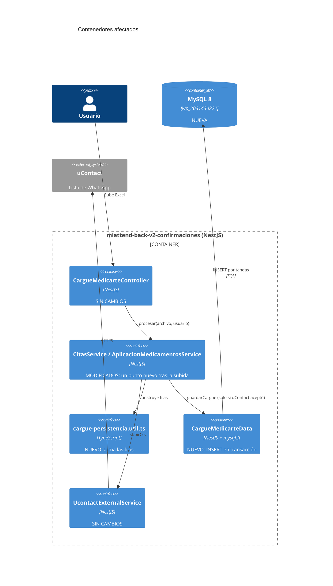
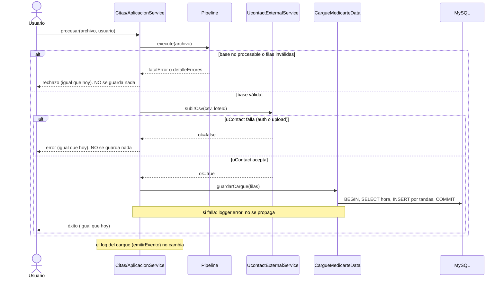

# Pitch: respaldo en BD del Cargue Medicarte (tabla `wp_2031430222`)

> Basado en [Shape Up, capítulo 6: Write the pitch](https://basecamp.com/shapeup/1.5-chapter-06). Plantilla: [Plantilla de Pitch](../Templates/Plantilla-Pitch.md). Este documento es la **especificación para implementar**: lo que dice aquí es lo que se escribe, ni más ni menos.

**Solicitado por:** origen en una pregunta del equipo en el chat; confirmar con [Mónica](../People/Monica.md) quién pide el parche
**Proyecto:** [Parche: persistencia del Cargue Medicarte](../Projects/Parche-Persistencia-Cargue-Medicarte.md)
**Fecha:** 2026-10-20 (reescrito; la versión anterior era de dos tablas)
**Estado:** **borrador en revisión. No implementar hasta que Víctor lo diga explícitamente.**
**Repositorio y rama:** `miattend-back-v2-confirmaciones`, rama `feature/confirmaciones-medicarte` (es parche del mismo requerimiento; ya se actualizó con `production`).
**Fuentes:** [Cargues masivos: inventario y patrones](../Wiki/Cargues-Masivos-Inventario-y-Patrones.md), [retrospectiva](../Projects/Retrospectiva-Cargue-Medicarte-Sin-Persistencia.md).

---

## 0. Resumen

1. Hoy el Cargue Medicarte (citas y aplicación de medicamentos) sube el CSV a uContact y **no guarda nada en la BD**. Solo emite una línea JSON al log, y el archivo de logs solo tenía el día de hoy.
2. Se agrega **un respaldo de lo que se envía**, imitando a los demás cargues masivos: **una sola tabla, `wp_2031430222`, con una fila por registro enviado** y los datos del registro ya transformado en una columna JSON (`script_fields`).
3. **Se guarda solo cuando uContact aceptó el archivo.** Si hay filas inválidas, la base no es procesable o uContact falla, **no se guarda nada**, igual que ningún otro cargue guarda errores (ver 1.1).
4. El guardado se hace **después** de que uContact responde y **antes** de armar la respuesta, esperando a que termine. Si falla, solo se registra en el log: **el usuario no ve ningún cambio** y el cargue nunca se rechaza por esto.
5. El flujo, las respuestas, los mensajes y el log existentes **no cambian**.
6. La tabla la crea **Víctor a mano**, primero en test. **Claude no ejecuta nada contra la BD ni corre `npm`, build o tests**: deja los comandos para Víctor.

---

## 1. Problema

- **Situación actual:** `CitasService` y `AplicacionMedicamentosService` (back 2, `src/cargueMedicarte/services/`) ejecutan extraer, validar estructura, validar registros, mapear, validar transformación, armar CSV y subir a uContact. En ningún punto escriben en la BD. El comentario del código dice: *"No hay persistencia: el resultado queda en los logs."*
- **Caso concreto:** al liberar el módulo, el equipo preguntó si había forma de validar los envíos de Medicarte. El archivo de logs procesado solo contenía el día de hoy, no la semana anterior. No se puede reconstruir qué bases se enviaron ni qué contenían.
- **Quién lo sufre:** el equipo cada vez que alguien pregunta "¿se cargó esta base?" o "¿qué se envió?".
- **Qué pasa si no se hace:** cada cargue sigue siendo irrecuperable en cuanto rotan los logs.
- **Por qué ocurrió:** ver la [retrospectiva](../Projects/Retrospectiva-Cargue-Medicarte-Sin-Persistencia.md).

### 1.1 Por qué solo se guarda lo enviado (hallazgo)

Se verificó en el código de los dos backs que **ningún cargue masivo guarda errores de validación**:

| Cargue | Qué pasa con lo que falla |
|---|---|
| Colsubsidio, Claro, TYT, orgánico (Back 1) | el front descarta las filas inválidas y el back solo recibe y guarda las válidas; si el webhook falla, solo hay `console.error` |
| Unicef | los `rechazados` (teléfono inválido o repetido, indicativo inválido) se devuelven en la respuesta y **no se guardan**; solo se insertan los válidos |
| WFM y Conexión | las filas con error van a `errors[]` en la respuesta; solo se insertan las válidas |
| Coordinator | `errors[]` y `errorCount` en la respuesta |
| Clusters | solo estados de procesamiento, no errores con motivo |

Por eso este respaldo imita ese patrón: **guarda lo que se envió y nada más**. Una versión anterior de este pitch guardaba también errores y rechazos; se descartó.

---

## 2. Appetite

- [x] **Small batch.** Es una tabla, una clase de datos y un punto de llamada en cada servicio. Lo escribe Claude.
- Lo que decide si queda hoy no es escribir el código, sino: crear la tabla en test (Víctor), compilar y probar (Víctor), aprobación de Mónica o revisión de Sergio, y el flujo Git completo con evidencia en Sonar.

---

## 3. Solución

### 3.1 Elementos clave

**Fijo (no se negocia):**
1. **Una sola tabla** `wp_2031430222`, una fila por registro enviado.
2. Se guarda **solo si uContact aceptó el archivo** (`carga.ok === true`).
3. Cada fila guarda el registro **ya transformado**, el mismo `contacto` del que se arma el CSV, en `script_fields` (JSON).
4. Un fallo al guardar **nunca** altera la respuesta ni rechaza el cargue (evita que el usuario vuelva a subir el archivo y los pacientes reciban el mensaje dos veces).
5. **SQL parametrizado**, estilo y esqueleto de transacción de Unicef y Clusters.
6. El **log del cargue no cambia** (la query de DuckDB sigue valiendo).
7. Ninguna respuesta, mensaje, endpoint ni código de estado cambia.

**Flexible:**
- Insertar por tandas de 1000 (si `max_allowed_packet` es grande, podría ser una sola sentencia).

### 3.2 Contexto (C4)





### 3.3 Flujo (secuencia)



**Mockup:** no aplica, no hay interfaz.

---

## 4. Modelo de datos

### 4.1 Origen del nombre

El nombre **`wp_2031430222`** salió de la conversación del equipo del 2026-10-20: [Sergio](../People/Sergio.md) validó que el código analítico de Medicarte confirmación de cita es **2031430222**; a las cargas que pasan a un bot se les agrega `bot_`, y como esto no es un bot, [Mónica](../People/Monica.md) propuso **`wp_`** más el código. Es **el nombre de la tabla tal cual**. Detalle en [Código analítico y nombres de tablas](../Wiki/Codigo-Analitico-y-Nombres-de-Tablas.md). La campaña que se carga es `WhatsAppMedicarteMasivo`.

> Sergio también dijo: *"créala similar a como está en test, esas las puedes crear"*. Antes de crearla, Víctor puede revisar si existe una tabla `wp_*` hermana en test para copiar su estilo: `SHOW TABLES LIKE 'wp\_%';` y `SHOW CREATE TABLE <una_wp_existente>;` (solo lectura).

### 4.2 Columnas

| Columna | Tipo | Contenido |
|---|---|---|
| `id` | int PK autoincrement | Llave primaria de cada registro |
| `codigo_lote` | varchar(64) | `medicarte-<tipo>-<timestamp>`; es el `loteId` que va en el nombre del archivo en uContact (`<campaña>_<codigo_lote>.csv`) |
| `tipo` | varchar(40) | `citas` o `aplicacion-medicamentos` |
| `nombre_archivo` | varchar(255) | Excel original |
| `fila` | int | Fila del Excel de ese registro (1-based, incluye encabezado) |
| `script_fields` | json NOT NULL | Registro ya transformado, tal como se armó para uContact |
| `fecha_creacion` | datetime | Hora de Colombia |
| `fecha_modificacion` | datetime | Igual al crear |
| `usuario_modificacion` | varchar(45) | Usuario del JWT |

**Por qué `script_fields`:** es el nombre que las tablas `bot_outbound*` y Unicef usan para el JSON del contacto/script, y deja `ori_fields` libre por si más adelante se quiere guardar también la fila original del Excel.

### 4.3 Contenido de `script_fields`

Es el `contacto` que ya existe en el pipeline (`MappedCitas.contacto` o `MappedAplicacionMedicamentos.contacto`), serializado con `JSON.stringify`.

Citas:
```json
{
  "clientId": "573001112233",
  "template": "<plantilla>",
  "priority": 1,
  "data": {
    "nombre": "Ana Perez", "especialidad": "Cardiología", "especialista": "Dr. Ejemplo",
    "fechaCita": "25/10/2026", "horaCita": "08:30", "sede": "Sede Norte", "documento": "1000000001"
  }
}
```
Aplicación de medicamentos: `clientId`, `template`, `priority` y `data` con `nombre`, `medicamento`, `sede`, `modalidad`, `fechaAplicacion`, `horaAplicacion`.

### 4.4 DDL

**Lo ejecuta Víctor a mano, primero en test (`10.36.35.8`).**

```sql
CREATE TABLE `wp_2031430222` (
  `id` int NOT NULL AUTO_INCREMENT COMMENT 'Llave primaria de cada registro',
  `codigo_lote` varchar(64) NOT NULL COMMENT 'Código del cargue; es el loteId del nombre del archivo en uContact (<campaña>_<codigo_lote>.csv)',
  `tipo` varchar(40) NOT NULL COMMENT 'Tipo de plantilla: citas o aplicacion-medicamentos',
  `nombre_archivo` varchar(255) DEFAULT NULL COMMENT 'Nombre del Excel cargado',
  `fila` int NOT NULL COMMENT 'Fila del Excel (1-based, incluye encabezado)',
  `script_fields` json NOT NULL COMMENT 'Contacto ya transformado y enviado a uContact (clientId, template, priority, data)',
  `fecha_creacion` datetime DEFAULT CURRENT_TIMESTAMP COMMENT 'Fecha de creación del registro.',
  `fecha_modificacion` datetime DEFAULT CURRENT_TIMESTAMP COMMENT 'Última fecha de modificación.',
  `usuario_modificacion` varchar(45) DEFAULT NULL COMMENT 'Usuario que hizo la última modificación.',
  PRIMARY KEY (`id`),
  KEY `idx_wp_2031430222_lote` (`codigo_lote`),
  KEY `idx_wp_2031430222_tipo_fecha` (`tipo`,`fecha_creacion`)
) ENGINE=InnoDB DEFAULT CHARSET=utf8mb4 COLLATE=utf8mb4_0900_ai_ci COMMENT='Respaldo de los registros enviados a uContact en los cargues de Medicarte';
```

El estilo (comentarios en español en cada columna, `datetime DEFAULT CURRENT_TIMESTAMP`, `varchar(45)` para usuarios, `InnoDB`, `utf8mb4`, `utf8mb4_0900_ai_ci`, nombres de índices con prefijo) se copió de los `SHOW CREATE TABLE` de `bot_outbound_unicef` y `bot_outbound_unicef_lote` (MySQL 8). Los comentarios copiados literalmente son los de `id`, `fecha_creacion`, `fecha_modificacion` y `usuario_modificacion`; el resto los escribió Claude y conviene leerlos antes de crear la tabla.

**Verificaciones previas en la BD (solo lectura, las corre Víctor):**
```sql
SHOW VARIABLES LIKE 'max_allowed_packet';
SHOW TABLES LIKE 'wp\_%';
SHOW GRANTS FOR CURRENT_USER();   -- con el usuario que usa la app (DB_USER)
```

---

## 5. Archivos: estado actual y estado objetivo

Todo en `miattend-back-v2-confirmaciones/src/cargueMedicarte/`.

### 5.1 Estado actual en disco (2026-10-20)

Existe una **versión previa de dos tablas, sin commitear y sin compilar**, que hay que reemplazar. Está en estos archivos:

| Archivo | Estado actual |
|---|---|
| `config/cargue-persistencia.config.ts` (nuevo) | constantes, 11 campos comunes y mapas de encabezados |
| `data/cargue-medicarte.data.ts` (nuevo) | inserta en `pipe_outbound_medicarte_lote` y `pipe_outbound_medicarte`, con `Promise.all` por tandas |
| `services/shared/cargue-persistencia.util.ts` (nuevo) | arma lote y registros, con estados y errores |
| `services/cargue-flow.types.ts` | agregados `origenes`, `CargableMapeado`, `CargueContexto` |
| `services/citas/citas.service.ts` y `services/aplicacion-medicamentos/aplicacion-medicamentos.service.ts` | contexto, `origenes`, `persistir` en el `finally` |
| `cargue-medicarte.module.ts` | provider `CargueMedicarteData` y comentario con los nombres viejos |

### 5.2 Estado objetivo

**N1. `config/cargue-persistencia.config.ts`**: se reduce a:
- `SQL_NOW_COLOMBIA = \`CONVERT_TZ(NOW(), @@session.time_zone, '-05:00')\`` (se duplica de Unicef porque el módulo es autocontenido).
- `TANDA_INSERT = 1000`.
- Largos para recortar: `LARGO_CODIGO_LOTE = 64`, `LARGO_TIPO = 40`, `LARGO_NOMBRE_ARCHIVO = 255`, `LARGO_USUARIO = 45`, `LARGO_MOTIVO_EXCEPCION = 1000` (para el log).
- Se eliminan: los 11 campos comunes, `ENCABEZADO_COMUN`, `ENCABEZADO_ESPECIFICO`, `COLUMNAS_COMUNES`, `LARGO_COLUMNA_COMUN`, los estados y las etapas.

**N2. `data/cargue-medicarte.data.ts`**: clase `CargueMedicarteData` con `Db2Service`.
- Interfaz `CargueRegistroInsert`: `codigo_lote`, `tipo`, `nombre_archivo`, `fila`, `script_fields` (string JSON), `usuario_modificacion`.
- Interfaz `GuardarCargueResultado`: `{ guardados: number }`.
- Método `guardarCargue(registros: CargueRegistroInsert[])`:
  1. `createConnection()` y `beginTransaction()`.
  2. `SELECT DATE_FORMAT(${SQL_NOW_COLOMBIA}, '%Y-%m-%d %H:%i:%s') AS ahora` una sola vez (como Unicef).
  3. Partir `registros` en tandas con `for (let i = 0; i < registros.length; i += TANDA_INSERT)` (**con `<`**: el bucle de Clusters usa `<=` y manda un array vacío si el total es múltiplo de 1000).
  4. `await Promise.all(tandas.map(...))` con `INSERT INTO wp_2031430222 (codigo_lote, tipo, nombre_archivo, fila, script_fields, fecha_creacion, fecha_modificacion, usuario_modificacion) VALUES ?` (por la misma conexión; evita el aviso `no-await-in-loop` de Sonar).
  5. `commit`. En el `catch`: `if ((error as { code?: string })?.code === 'ECONNRESET') throw error;` y si no, `rollback` y `throw`. En el `finally`: `connection.end().catch(() => undefined)`.
- Sin consultas de lectura.

**N3. `services/shared/cargue-persistencia.util.ts`**: funciones puras.
- `construirRegistros(evento: CargueWideEvent, cargables: { fila: number; contacto: unknown }[]): CargueRegistroInsert[]`: una fila por cargable, con `codigo_lote = evento.loteId`, `tipo = evento.tipo`, `nombre_archivo = evento.archivo`, `fila`, `script_fields = JSON.stringify(contacto)` y `usuario_modificacion = evento.usuario`. Aplica `recortar` a los textos.
- `recortar(valor, max)`: recorta al largo y quita un par sustituto partido (con `codePointAt`).
- `mensajeDeError(error: unknown)`: mensaje (nunca el stack), recortado a 1000.
- Se eliminan: `crearContexto`, `construirOrigenes`, `construirLote`, `extraerComunes`, `extraerEspecificos`, `registroConError`, `registroCargable` y `construirPersistencia`.

**M1. `services/cargue-flow.types.ts`**: **se restaura a su versión original** (sin `origenes`, `CargableMapeado`, `CargueContexto` ni el import de `UcontactUploadResult`).

**M2 y M3. `citas.service.ts` y `aplicacion-medicamentos.service.ts`**:
- Se restauran `procesar()` (sin contexto, sin cambios en el `catch` ni en el `finally`), `execute()` (sin `origenes`) y `ejecutarCargue()` (sin contexto) a su versión original.
- El comentario de `procesar()` deja de decir "No hay persistencia" y menciona el respaldo.
- Constructor: se mantiene `private readonly cargueData: CargueMedicarteData`.
- **Único punto nuevo**, en `subirAUcontact`, justo después de `const carga = await this.uploader.subirCsv(...)` y antes de `construirRespuestaCarga`:
  ```ts
  if (carga.ok) await this.persistir(evento, pipeline.cargables);
  ```
- Método privado `persistir(evento, cargables)`: `try { await this.cargueData.guardarCargue(construirRegistros(evento, cargables)); } catch (error) { logger.error(\`[CargueMedicarte] Lote ${evento.loteId}: no se pudo guardar el respaldo en la BD: ${mensajeDeError(error)}\`); }`. **No relanza.**
- Se mantienen los imports de `logger` y `CargueMedicarteData`; se ajustan los de `cargue-persistencia.util`.

**M4. `cargue-medicarte.module.ts`**: se mantiene el provider `CargueMedicarteData`; el comentario pasa a decir `wp_2031430222`.

### 5.3 Lo que NO se toca
Controlador, pipe, todos los pasos del pipeline (incluidos los `build-csv.step.ts`), `cargue-respuestas.util.ts`, `UcontactExternalService`, `medicarte.config.ts`, el logger, el front y Back 1.

---

## 6. Rabbit holes

| Riesgo | Decisión |
|---|---|
| **Datos que no caben en una columna** (`nombre_archivo` hasta 255, usuario 45) | `recortar()` antes de insertar, para que un valor largo no haga fallar toda la transacción |
| **`max_allowed_packet`** (no verificado) | Tandas de 1000; con 300 registros típicos es una sola tanda. Si el valor es pequeño, bajar `TANDA_INSERT` |
| **Fallo de la BD al guardar** | `try/catch` propio en `persistir`; no se propaga. El usuario ve exactamente lo mismo |
| **BD caída o lenta** | El guardado se espera. `Db2Service` no define tiempo límite de conexión y `mysql2` usa 10 s por defecto, que se sumarían al request. Víctor aceptó que esperar un poco más no cuenta como alterar la experiencia; en el peor caso (BD caída y uContact usando casi sus 19 s), el front, que corta a los 20 s, podría mostrar error aunque uContact ya aceptó la lista |
| **Tabla inexistente en un entorno** | El cargue sigue igual; queda un `logger.error` por cargue. Orden: crear la tabla primero, desplegar el código después |
| **`develop` y `production` comparten host y base** | En `env/interactivo`, ambas apuntan a `192.168.100.91` y `dev_miattend_interactivo`. Crear la tabla "en develop" es crearla en producción. Test es otro host (`10.36.35.8`). Confirmar con Sergio |
| **Vuelven a subir el archivo tras un error de guardado** | No ocurre: el guardado nunca altera la respuesta |

---

## 7. No-gos

- No se guardan errores, rechazos ni cargues fallidos (ningún otro cargue lo hace).
- No se guarda la fila original del Excel (las columnas que no van a uContact, como EPS, tipo de gestión, tipo de documento, dirección, ciudad, observaciones).
- No se guarda el Excel ni el CSV completo en una columna.
- No se agrega estado de envío ni consulta de entrega: el módulo solo envía.
- No hay endpoints de lectura, reproceso ni pantalla en el front.
- No se tocan Back 1, el front ni los demás cargues.
- No se cambian respuestas, mensajes, validación estricta ni el log JSON.
- No se usa patrón Observer ni eventos (se evaluó y se descartó: con un solo guardado es más ceremonia que beneficio).
- No se versiona el DDL en el repo; no hay carpeta de SQL ni migraciones en back 2 (sin ORM).
- **Claude no ejecuta** `npm`, builds, tests ni comandos contra la BD.

---

## 8. Impacto

- **Usuario final:** ninguno visible. Mismas respuestas y mensajes. La respuesta puede tardar un poco más por el guardado.
- **Tiempo estimado del guardado** (estimaciones mías, **sin medir**): para 300 registros, una sola tanda, unos 50 a 200 ms (conexión, `BEGIN`, `SELECT`, `INSERT` de 300 filas, `COMMIT`). Para el máximo del módulo (`maxRegistros: 20000`), unas 20 tandas, de 2 a 6 s.
- **Equipo:** se puede responder con SQL qué se envió, cuándo, quién y con qué archivo, sin depender de los logs.
- **Lo que no responde:** cuántas veces se **intentó** cargar ni por qué se rechazó. Eso sigue solo en el log (query de DuckDB en la [nota de diseño](../Wiki/Cargue-Medicarte-Diseno-Persistencia.md)). Tampoco prueba la entrega del WhatsApp: el módulo solo envía.
- **BD:** una tabla nueva, sin tocar las existentes. Crecimiento: una fila por registro enviado, del orden de 1 KB cada una (estimación).
- **Seguridad y datos personales:** la tabla guarda en texto plano datos de pacientes (nombre, documento, teléfono, especialidad, sede, fecha y hora de cita). Medidas ya en el diseño: SQL parametrizado (el nombre de la tabla y las claves salen de constantes), ningún dato de pacientes en los logs (solo `loteId` y el mensaje, recortado y sin stack), usuario tomado del JWT (`req.user.username`), sin endpoints nuevos, transacción por cargue.
- **Seguridad fuera del código** (decisiones pendientes): privilegios del usuario de BD (solo `INSERT` sobre esta tabla), quién puede hacer `SELECT` (incluidas herramientas de reportes conectadas a esa base), retención, y los respaldos de la BD, que también tendrán copia. Los datos de salud son sensibles bajo la Ley 1581 de 2012; confirmar con quien maneje protección de datos en la empresa.
- **Despliegue:** 1) Víctor crea la tabla en test. 2) Se implementa en `feature/confirmaciones-medicarte`. 3) Se prueba en test. 4) Antes de llevar el código a `production`, la tabla debe existir en la BD de producción. 5) [Flujo Git](../Projects/Flujo-Git.md): `feature/confirmaciones-medicarte` → `integration` → `develop` → `test` → `production`, con el mismo nombre de rama.
- **Dónde se crea la tabla (decisión de Víctor, 2026-10-20):** Víctor la crea a mano en **test** y en **develop**. La de producción la crean Sergio y su equipo cuando se lo indiquen. Víctor indicó que develop y producción no comparten base, aunque los `.env` del repo apuntan ambos a `192.168.100.91`; lo confirma él antes de crear la tabla en develop.
- **Rollback:** revertir los commits y volver a desplegar. La tabla puede quedarse. Solo si Víctor lo decide explícitamente: `DROP TABLE wp_2031430222;` (acción destructiva, no la ejecuta Claude).
- **Riesgo del cambio:** bajo. El guardado está aislado y solo ocurre después de un envío exitoso.

---

## 9. Plan de pruebas

**Las corre Víctor.** Comandos del `package.json` del back 2:
- `npm run build` (`nest build`): compila y revela errores de tipos.
- `npm run test`: **no es jest**, ejecuta `NODE_ENV=test nest start` con `env/interactivo/test.env`.

**Casos manuales en test:**

| # | Caso | Respuesta esperada | Filas en `wp_2031430222` |
|---|---|---|---|
| 1 | Citas, base válida, ~300 filas | igual que hoy | una por registro, `tipo=citas`, `script_fields` con `clientId`, `template`, `priority` y `data` |
| 2 | Medicamentos, base válida | igual que hoy | una por registro, `tipo=aplicacion-medicamentos` |
| 3 | Citas con filas inválidas | rechazo con detalle (igual que hoy) | **ninguna** |
| 4 | Excel sin datos o sin las columnas requeridas | base no procesable | **ninguna** |
| 5 | uContact caído o sin acceso | error de carga (igual que hoy) | **ninguna** |
| 6 | 2500 filas válidas | igual que hoy | 2500 (3 tandas) |
| 7 | 2000 filas válidas (múltiplo de 1000) | igual que hoy | 2000 (el caso del bucle `<=` de Clusters) |
| 8 | Nombre de archivo muy largo | igual que hoy | se guarda con `nombre_archivo` recortado |
| 9 | Tabla inexistente (antes del DDL) | **igual que hoy** | nada; un `logger.error` por cargue |
| 10 | Sin permiso `INSERT` | **igual que hoy** | nada; un `logger.error` por cargue |

**Consultas de verificación (solo lectura):**
```sql
SELECT codigo_lote, tipo, COUNT(*) filas, MIN(fecha_creacion) fecha
FROM wp_2031430222 GROUP BY codigo_lote, tipo ORDER BY fecha DESC LIMIT 10;

SELECT fila, script_fields FROM wp_2031430222 WHERE codigo_lote = ? ORDER BY fila LIMIT 5;

SELECT DATE(fecha_creacion) dia, tipo, COUNT(DISTINCT codigo_lote) cargues, COUNT(*) registros
FROM wp_2031430222 GROUP BY dia, tipo ORDER BY dia;
```

**Criterios de aceptación:**
- [ ] Los 10 casos dan lo esperado.
- [ ] La respuesta HTTP es idéntica a la de antes del parche en todos los casos.
- [ ] El log JSON del cargue es idéntico al de antes.
- [ ] `npm run build` termina sin errores y Sonar no marca avisos nuevos.

---

## 10. Commits sugeridos (rama `feature/confirmaciones-medicarte`)

1. `config y capa de datos para respaldar el cargue medicarte en wp_2031430222`
2. `armado de registros y respaldo tras el envio exitoso a ucontact`

---

## 11. Historial de decisiones

| Decisión | Motivo |
|---|---|
| Dos tablas (lote y registros) → **una tabla** | Víctor: así lo hacen los demás cargues |
| Nombres `pipe_outbound_medicarte*` → **`wp_2031430222`** | Sergio: la tabla lleva el código analítico del servicio; Víctor recibió ese nombre |
| 11 campos comunes como columnas → **JSON** | Víctor: el campo JSON lleva la fila estructurada |
| Guardar errores y rechazos → **solo lo enviado** | Ningún otro cargue guarda errores; el respaldo imita a los demás |
| `ori_fields` / `datos` → **`script_fields`** | Convención de `bot_outbound*` y Unicef; guarda el contacto ya transformado |
| Guardar siempre en el `finally` → **solo si uContact aceptó, dentro de `subirAUcontact`** | Menos cambios al flujo; coherente con "solo lo enviado" |
| Guardado sin `await` / con tope de tiempo → **`await` simple** | Víctor: esperar un poco más no cuenta como alterar la experiencia |
| Observer, `Subject` de rxjs, `@nestjs/event-emitter` → **descartado** | Con un único guardado es más ceremonia que beneficio |
| `Promise.all` por tandas | Sonar marcaba `await` dentro de un bucle (`no-await-in-loop`) |

---

## 12. Preguntas abiertas

1. **Resuelto (2026-10-20):** Sergio dio el nombre `wp_2031430222` y Víctor crea la tabla él mismo. Opcional: revisar si existe una tabla `wp_*` hermana en test para copiar su estilo.
2. `SHOW GRANTS FOR CURRENT_USER();` con el usuario de la app: ¿tiene `INSERT` sobre la tabla nueva o hay que dar el `GRANT`?
3. `max_allowed_packet` de test y producción.
4. ¿Quién puede consultar la tabla y por cuánto tiempo se conserva (retención)?
5. **Aclarado por Víctor (2026-10-20):** develop y producción **no** comparten base (los `.env` de la rama `production` del repo decían lo contrario: ambas con `192.168.100.91`; Víctor lo gestiona). La tabla se crea en **test** y en **develop** (Víctor); la de **producción** la crean ellos (Sergio y su equipo) cuando se lo indiquen.
6. Origen del pedido: Mónica estuvo preguntando por el código analítico y por si Sergio había creado tablas (conversación 2026-10-20); confirmar con ella si el alcance (una tabla, respaldo de lo enviado) le parece bien.
7. Revisión de [Sergio](../People/Sergio.md) del diseño.

---

## 13. Checklist de implementación (cuando Víctor diga "implementa")

- [ ] Víctor responde las preguntas 1, 2 y 5 de la sección 12 como mínimo.
- [ ] Víctor crea la tabla en test con el DDL de 4.4.
- [x] Claude reescribe N1, N2 y N3 (2026-10-20, sin commitear y sin compilar).
- [x] Claude restaura M1, M2 y M3 a su versión original y agrega el único punto nuevo; ajusta M4 (2026-10-20, sin commitear y sin compilar).
- [ ] Víctor corre `npm run build`.
- [ ] Víctor prueba los 10 casos de la sección 9 con `npm run test`.
- [ ] Víctor sube evidencia en la tarea y en Sonar.
- [ ] Flujo Git hasta `production`, con la tabla ya creada en cada entorno.
- [ ] Actualizar el [tablero del parche](../Projects/Parche-Persistencia-Cargue-Medicarte.md) y el [Journal](../Journal/2026-10-15.md).

---

## Notas de implementación (2026-10-20)

Código escrito en `feature/confirmaciones-medicarte`, **sin commitear y sin compilar** (Víctor corre `npm run build`). Quedó como la sección 5.2, con estos detalles:

- **Archivos nuevos:** `config/cargue-persistencia.config.ts`, `data/cargue-medicarte.data.ts` y `services/shared/cargue-persistencia.util.ts`.
- **Modificados:** `citas.service.ts`, `aplicacion-medicamentos.service.ts` y `cargue-medicarte.module.ts`. `cargue-flow.types.ts` quedó como el original (git lo marca como modificado solo por los saltos de línea).
- **Único punto nuevo en cada servicio**, en `subirAUcontact`: `if (carga.ok) await this.persistir(evento, pipeline.cargables);`
- `persistir` recibe `(evento, cargables)`, captura todo error y registra `[CargueMedicarte] Lote <loteId>: no se pudo guardar el respaldo en la BD: <mensaje>`. No relanza.
- **`CargableRespaldo`** (`{ fila, contacto }`) vive en el util; los tipos `MappedCitas` y `MappedAplicacionMedicamentos` son compatibles.
- **`guardarCargue`** devuelve `{ guardados: 0 }` sin abrir conexión si no hay registros.
- La constante de recorte del mensaje de error se llama `LARGO_MENSAJE_ERROR` (antes `LARGO_MOTIVO_EXCEPCION`).
- Las tandas se arman primero y se envían con `Promise.all` por la misma conexión (evita el aviso `no-await-in-loop` de Sonar).

---

## Anexo: qué se verificó y qué no

**Verificado leyendo el código:**
- Los dos servicios (flujo, `procesar`, `execute`, `ejecutarCargue`, `subirAUcontact`) y que `subirAUcontact` recibe `pipeline.cargables` y `evento` (con `usuario`, `loteId`, `tipo`, `archivo`).
- Que `MappedCitas` y `MappedAplicacionMedicamentos` traen `{ fila, origen, contacto }`, y `fila` es la fila real del Excel.
- `UcontactExternalService`: `auth` y `upload`, resultado binario, `${campaign}_${loteId}.csv`, presupuesto de 19 s (el front corta a los 20 s).
- El formato del CSV: `campaign;telefono;"hsm;template;text;vars";priority`, sin cabecera, variables en un orden fijo por plantilla.
- `CommonModule` exporta `Db2Service`; back 2 no usa ORM (solo `mysql2`); `package.json` sin `@nestjs/event-emitter`.
- DDL de `bot_outbound_unicef` y `bot_outbound_unicef_lote` (pegados por Víctor): MySQL 8.
- `env/interactivo/*.env`: solo `DB_HOST`, `DB_DATABASE` y `DB_PORT`; no se leyeron contraseñas.

**No verificado:**
- `max_allowed_packet`, permisos reales del usuario de BD y si existe una tabla `wp_*` hermana.
- Si `wp_` implica una estructura estándar (es una indicación de Sergio, no deducida del repo).
- Quién escribió el comentario "No hay persistencia" y cuándo (no se corrió `git blame`).
- Los tiempos y tamaños de la sección 8 son estimaciones mías, no medidas.
- El código nuevo **no se ha compilado**.

Volver a [Home](../Home.md) · [Pitches](Pitches.md)
