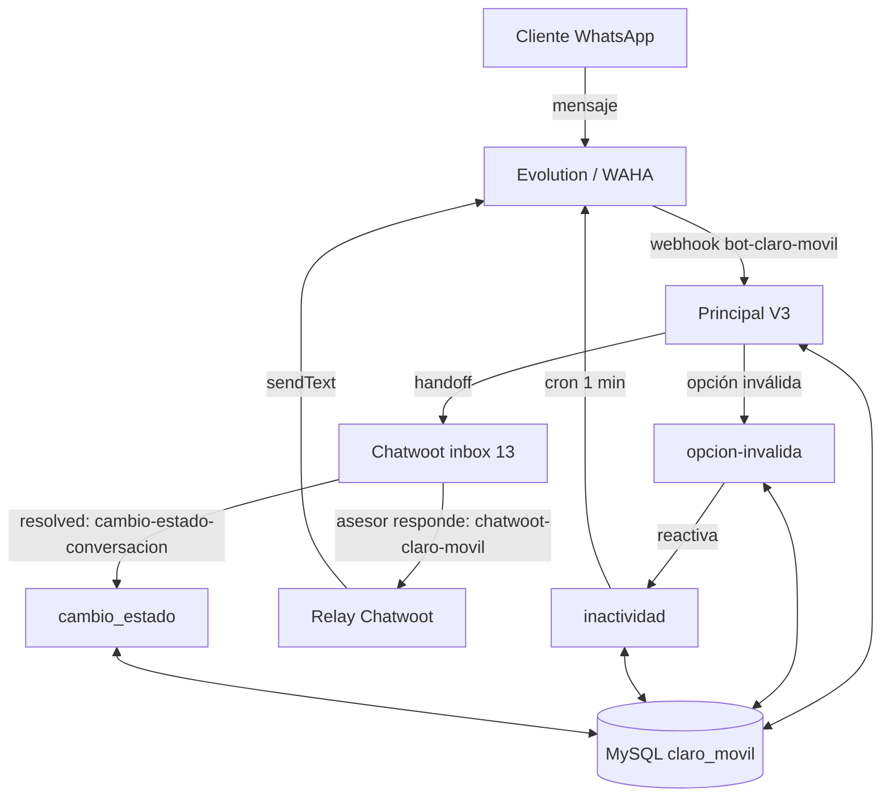

# CLARO_MOVIL: documentación de los flujos n8n (Evolution)

Estudio de los 5 workflows exportados en [n8n-json](../n8n-json/README.md), para migrarlos a WAHA. Parte de [Migración WAHA: CLARO_MOVIL](Migracion-WAHA-CLARO_MOVIL.md). Guía general: [Migración Evolution → WAHA](../Wiki/Migracion-Evolution-a-WAHA.md).

**Qué hace el bot:** atiende por WhatsApp a quien escribe a la línea de Claro Móvil con un menú numérico (portabilidad, ofertas, migración), registra todo en Chatwoot (inbox 13) y, cuando corresponde, pasa la conversación a un asesor. El estado de cada cliente vive en la tabla MySQL `claro_movil`.

## Hallazgos que importan ya
1. **Los webhooks no coinciden.** El flujo principal escucha en `/webhook/bot-claro-movil`, pero WAHA quedó apuntando a `/webhook/recepcion-whatsapp-claro-movil`. Hay que crear ese webhook (o repuntar WAHA) y decidir cuál queda.
2. **Dominios n8n distintos.** Los flujos se llaman entre sí con `2031510-n8n.interactivo.com.co`; el webhook de WAHA usa `n8n-general.interactivo.com.co`. Confirmar cuál es el vigente para no romper las llamadas internas (`url_n8n`, `opcion-invalida`, `inactividad`, `cambio-estado`).
3. **Sesión:** todos los flujos usan `session = AGENTE_PRUEBA_1`, igual al agente que sincronizó Sergio. Coincide, pero es el nombre de *prueba*; confirmar que es el definitivo.
4. **Credenciales en claro dentro de los JSON** (API key de Chatwoot y de Evolution, repetidas en cada nodo `Set` y hasta en el body de `opcion-invalida`). No están copiadas en esta nota. Conviene moverlas a credenciales de n8n o a variables y rotarlas, porque estos archivos están en la bóveda (que tiene git).
5. **Chatwoot en dos URLs:** los flujos usan `botconnect.interactivo.com.co:8443`; el Excel dice `chatwoot-general.interactivo.com.co`. Confirmar cuál es el real.

## Mapa de flujos

| Archivo | Disparador | Función |
|---|---|---|
| Principal V3 (Evolution) | Webhook `bot-claro-movil` | Máquina de estados del menú, crea contacto/conversación en Chatwoot, ubicación, handoff a asesor |
| Webhook_chatwoot (relay) | Webhook `chatwoot-claro-movil` | Reenvía a WhatsApp lo que escribe el asesor (solo si `paso = -1`) |
| cambio_estado_conversacion | Webhook `cambio-estado-conversacion-claro-movil` | Cuando la conversación pasa a `resolved`, deja `paso = 1000` |
| inactividad | Cron cada 1 min | Recordatorios por inactividad y cierre tras 3 avisos |
| opcion-invalida | Webhook `opcion-invalida-claro-movil` | Cuenta errores, reenvía el menú del paso actual; al 3.º error cierra |

## Estados (`paso`) en `claro_movil`
| paso | Significado |
|---|---|
| 0 / 1000 | Sin conversación activa / cerrada (crea o reutiliza conversación) |
| 1 | Bienvenida enviada, espera SI |
| 2 | Menú 1–5 |
| 3 | Pregunta SI/NO (portabilidad: ¿el número recibe llamadas?) |
| 4 | Oferta de planes 1–4 |
| 5 | Habeas data SI/NO |
| -1 | Handoff: atiende un asesor |

Columnas usadas: `cliente` (teléfono), `tipo`, `id_cuenta`, `id_inbox`, `id_conversacion`, `paso`, `num_advertencia`, `num_errores`, `session_wpp`, `etiqueta_chatwoot`, `ori_fields` (JSON de trazabilidad), `fecha_modificacion`.

## Flujo Principal, resumen
1. `Webhook entrada` → `Es texto entrante?` descarta `fromMe`.
2. `Es ubicacion?`: si es ubicación → normaliza, valida coordenadas, geocodifica con Nominatim, la registra en Chatwoot y en `ori_fields`; si no es válida avisa por WhatsApp.
3. Si es texto: `Variables globales` → `Obtener estado` (MySQL) → `Variables del menú` → registra el mensaje entrante en Chatwoot → `Enrutar por estado`.
4. Estado 0/1000: busca contacto en Chatwoot (crea si no existe), reutiliza conversación abierta del inbox 13 o crea una, guarda estado `1`, envía bienvenida por WhatsApp y Chatwoot.
5. Estados 1–5: validan la respuesta (regex SI/NO, 1–5, 1–4); si es inválida llaman a `opcion-invalida`.
6. Cada rama termina en `Consolidar` → `Guardar estado` → `Enviar WhatsApp` → `Enviar Chatwoot` → `¿Handoff?`.
7. Handoff: lista miembros del inbox, filtra agentes online, elige el menos cargado, asigna y etiqueta (`claro-terminales`, `claro-migracion`, `claro-portabilidad`).

## Lo que cambia con WAHA, nodo por nodo
### A. Envío (12 nodos `sendText`)
Principal (3: `Enviar WhatsApp`, `Bienvenida WhatsApp`, `Error ubicacion`), relay (1), inactividad (1), opcion-invalida (7).

| Evolution | WAHA |
|---|---|
| `POST {url_evolution}/message/sendText/{session}` | `POST {url_waha}/api/sendText` |
| header `apikey` | header `X-Api-Key` |
| `{ "number": "57300...", "text": "..." }` | `{ "session": "AGENTE_PRUEBA_1", "chatId": "57300...@c.us", "text": "..." }` |

- Sale `message_type: "outgoing"` en el body del `Bienvenida WhatsApp` y del relay: es un campo de Chatwoot que no pertenece a ese endpoint; en WAHA se quita.
- El relay arma el texto con `.replace(/"/g," ")` a mano; mejor `JSON.stringify` como en los demás.
- Variables `url_evolution` / `api_evolution` → renombrar a `url_waha` / `api_waha`. Aparecen también en el body que `Principal` manda a `opcion-invalida` (14 + 16 ocurrencias): hay que cambiar ambos lados a la vez.

### B. Recepción (solo `Principal`)
| Campo que lee hoy | Equivalente WAHA (⚠️ validar con payload real) |
|---|---|
| `body.data.key.remoteJid.split('@')[0]` | `body.payload.from.split('@')[0]` (ojo: puede venir `@lid` según motor) |
| `body.data.key.fromMe` | `body.payload.fromMe` |
| `body.data.message.conversation` | `body.payload.body` |
| `body.data.message.extendedTextMessage.text` | `body.payload.body` |
| `locationMessage` / `liveLocationMessage` / `deviceSentMessage` | `body.payload.location` (latitud/longitud) ⚠️ ver cómo llega la ubicación en vivo |
| `data.key.id` | `body.payload.id` |
| (sin filtro de evento) | filtrar `body.event == "message"` |

Referencias a cambiar: ≈30 expresiones `$('Webhook entrada').item.json.body.data...`. Lo más limpio es un nodo `Set`/`Code` al inicio que normalice a `{ phone, texto, fromMe, ubicacion }` y que el resto lea de ahí, como recomienda la [guía](../Wiki/Migracion-Evolution-a-WAHA.md) (capa adaptadora).

### C. Sin cambios
Todo lo de Chatwoot (contactos, conversaciones, mensajes, etiquetas, asignaciones), MySQL, el geocodificado Nominatim, cron de inactividad (salvo su `sendText`) y `cambio_estado_conversacion` (no usa Evolution).

## Riesgos y detalles a vigilar
- **Eco/bucles:** el relay solo reenvía si `message_type = outgoing`, `sender.type = user` y `source_id != bot`. Se mantiene igual, pero en WAHA hay que filtrar `fromMe` también en el trigger.
- **Mensajes de grupo:** el flujo no filtra `@g.us` hoy; con WAHA conviene descartarlos.
- **Mensajes que no son texto** (imagen, audio): `Registrar entrante Chatwoot1` cae en `[Ubicación enviada]`; revisar el comportamiento con `payload.body` vacío.
- **Inyección en SQL:** los `INSERT/UPDATE` interpolan `cliente` directo. Con WAHA `from` cambia de formato; normalizar antes de usarlo.
- **Antibloqueo:** el bot responde de inmediato; en WAHA añadir `startTyping`/`stopTyping` o una espera corta ([antibloqueo](../Wiki/WAHA-Seguridad-y-Antibloqueo.md)). La inactividad envía recordatorios cada minuto en lote: vigilar el ritmo.
- **Convivencia:** mientras prueban, un mismo número no debe estar en Evolution y en WAHA para este flujo.

## Plan propuesto (sin ejecutar)
1. Resolver los 5 hallazgos con Sergio (webhook, dominio n8n, sesión, URL Chatwoot, credenciales).
2. Clonar los 5 workflows con sufijo `(WAHA)`, sin tocar los de Evolution.
3. Crear el nodo normalizador en `Principal` y capturar un payload real de WAHA para fijar el mapeo de la sección B.
4. Cambiar los 12 `sendText` y las variables.
5. Probar: bienvenida, cada opción, opción inválida ×3, inactividad, handoff, ubicación, respuesta de asesor desde Chatwoot.
6. Evidencia y corte según la guía.

Relacionado: [Sergio](../People/Sergio.md) · [Mónica](../People/Monica.md) · [WAHA](../Wiki/WAHA.md) · [WAHA + n8n](../Wiki/WAHA-con-n8n.md) · [WAHA webhooks](../Wiki/WAHA-Webhooks.md)

Volver a [Home](../Home.md)
