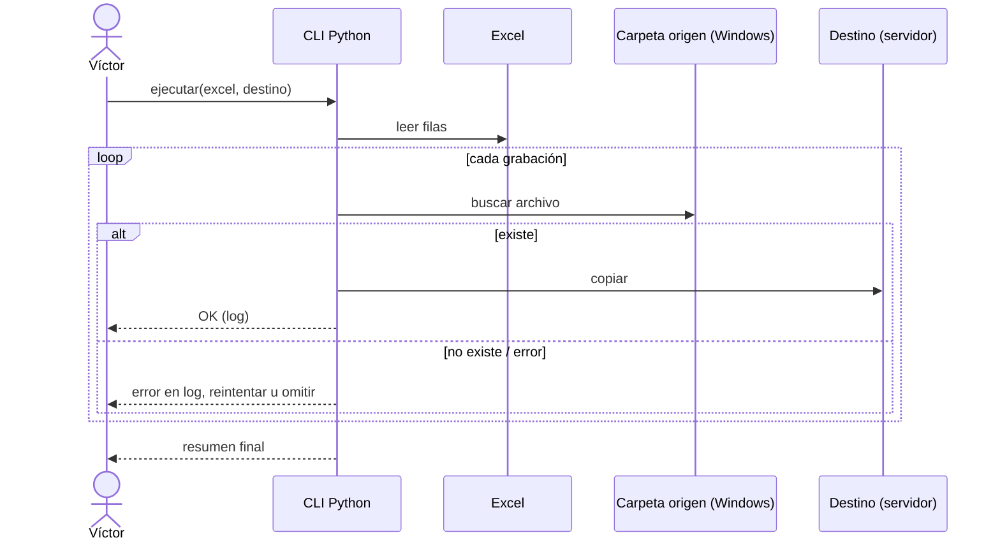

# Migración de grabaciones

**Qué es:** entregable **único** (no se repetirá). A partir de un Excel, buscar archivos de grabación en una carpeta de Windows y, si existen, copiarlos a otra ubicación del servidor.
**Pedido por:** [Mónica](../People/Monica.md) (a petición de la operación)
**Estado:** cerrado (informativo). Solución propuesta y revisada con Mónica.

## Problema
La operación necesita entregar grabaciones. Hoy no hay forma automática de localizarlas a partir de una lista y copiarlas.

## Appetite
Small batch: sin interfaz, sin automatización recurrente. Fin del entregable cuando se entregan las grabaciones.

## Solución
CLI en Python: recibe el Excel y la ruta destino. Para cada fila busca la grabación, la copia y registra el resultado en logs.

- Si una copia falla, permite **reintentar** o **omitir** y continuar.
- Los logs dicen qué archivo falló y por qué, para resolver el caso puntual después.
- Se opera toda la migración desde una terminal.

## Rabbit holes
- **Antivirus** o permisos pueden bloquear carpetas profundas o ubicaciones exóticas → el log indica cuál; se intenta a mano o se pide permiso.
- Excel distintos con formatos distintos → validar columnas antes de empezar.

## No-gos
- Sin front para subir el Excel.
- Sin ejecución automática ni trigger de vigilancia de carpeta.

## Pasos que se plantearon (histórico)
- [ ] Esperar accesos al servidor y recibir todos los Excel.
- [ ] Revisar el correo con la solución que envió Mónica.
- [ ] Implementar y probar con un Excel pequeño.

Basado en la [Plantilla de Pitch](../Templates/Plantilla-Pitch.md). Volver a [Home](../Home.md)
