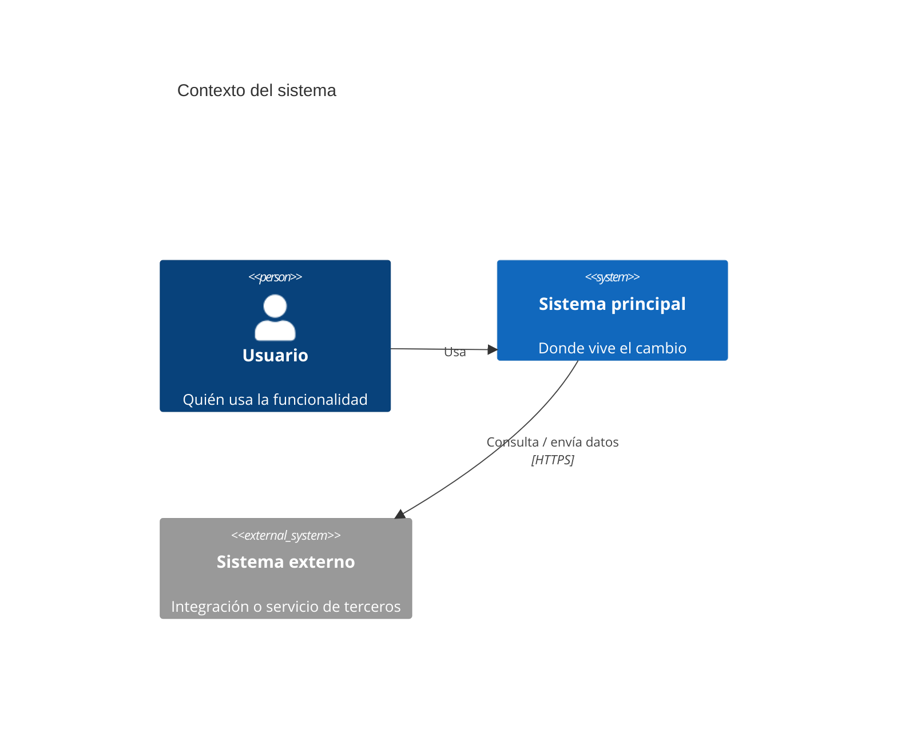
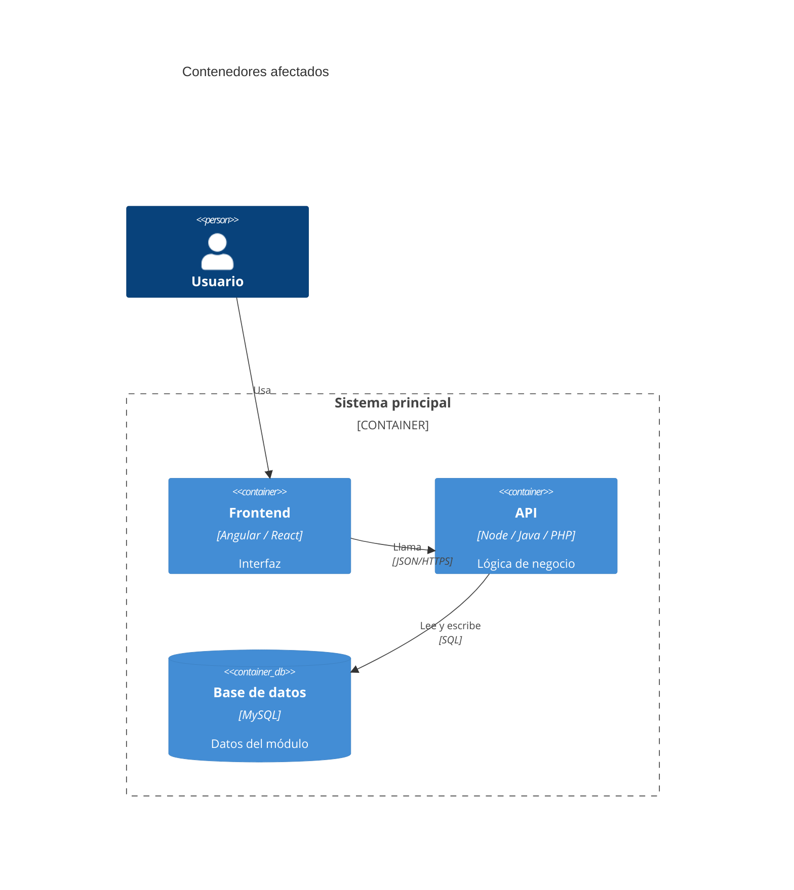
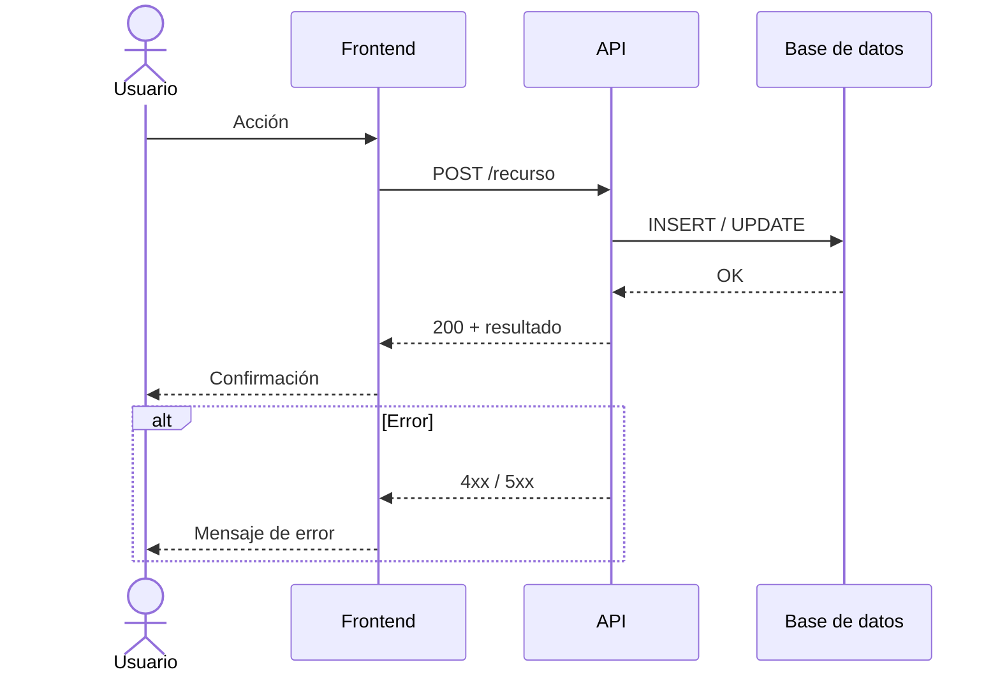

# Pitch: <Nombre del desarrollo>

> Basado en [Shape Up, capítulo 6: Write the pitch](https://basecamp.com/shapeup/1.5-chapter-06). Copia esta plantilla a `Pitches/` y rellénala **antes** de escribir código.

**Solicitado por:** [Persona](../People/)
**Proyecto:** [Proyecto](../Projects/)
**Fecha:** AAAA-MM-DD
**Estado:** borrador | en revisión | aprobado | descartado

---

## 1. Problema
Qué pasa hoy y por qué duele. Incluye un caso concreto (un ticket, un usuario, una situación real), no una abstracción.

- Situación actual:
- Quién lo sufre y con qué frecuencia:
- Qué pasa si no se hace:

## 2. Appetite
Cuánto tiempo estamos dispuestos a invertir. Es un presupuesto, no una estimación.

- [ ] Small batch (1-2 días)
- [ ] Medium (1 semana)
- [ ] Big batch (2-6 semanas)

## 3. Solución
Describe la solución con suficiente detalle para que se entienda, pero sin sobre-especificar. Marca qué es fijo y qué es flexible.

### 3.1 Elementos clave
1.
2.
3.

### 3.2 Contexto (C4, nivel 1 y 2)





### 3.3 Flujo (diagrama de secuencia)



### 3.4 Mockup (solo si hay interfaz gráfica)

```text
+--------------------------------------------------+
|  Título de la pantalla                      [X]  |
+--------------------------------------------------+
|  Filtro: [____________]   [ Buscar ]             |
|                                                  |
|  +--------+------------------+-----------+       |
|  | ID     | Nombre           | Estado    |       |
|  +--------+------------------+-----------+       |
|  | 001    | Ejemplo uno      | Activo    |       |
|  | 002    | Ejemplo dos      | Inactivo  |       |
|  +--------+------------------+-----------+       |
|                                                  |
|            [ Cancelar ]   [ Guardar ]            |
+--------------------------------------------------+
```

## 4. Rabbit holes
Riesgos técnicos o dudas que podrían hacernos perder tiempo, y cómo los evitamos.

- Riesgo: ... → Decisión:
- Riesgo: ... → Decisión:

## 5. No-gos
Lo que **no** se va a hacer en este desarrollo para respetar el appetite.

-
-

## 6. Preguntas abiertas
-

---
Volver a [Home](../Home.md)
