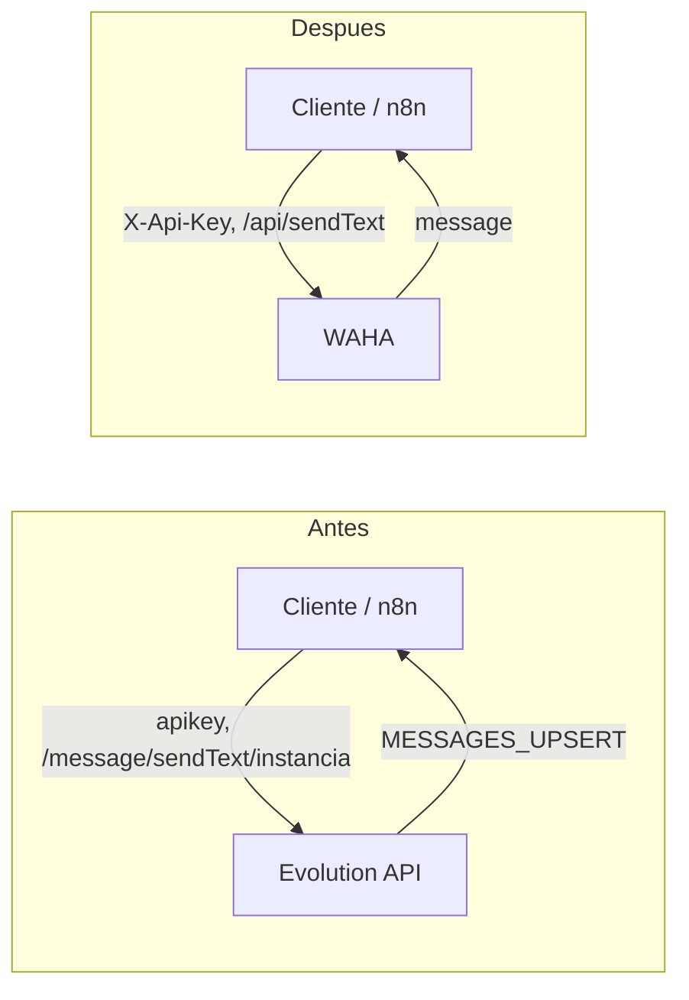
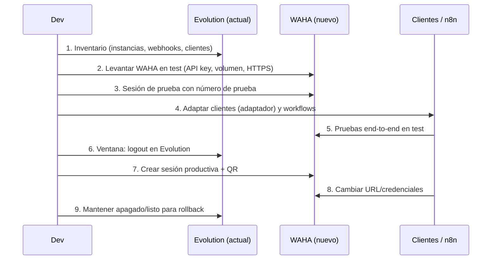

# Migración: Evolution API → WAHA

Guía para pasar los envíos y recibos de WhatsApp de [Evolution API](Evolution-API.md) a [WAHA](WAHA.md). No existe una guía oficial de migración (se buscó); esta nota la arma comparando ambas documentaciones. Es una plantilla de trabajo: **nada aquí está ejecutado**, y los puntos marcados con ⚠️ hay que validar en un ambiente de prueba.

## 1. Idea general
Evolution y WAHA son equivalentes funcionales (REST + webhooks sobre WhatsApp Web), pero **no son compatibles entre sí**: cambian las URLs, la autenticación, los nombres de campos, el formato del `chatId` y el payload de los webhooks. Migrar es reescribir el "contrato" en los clientes (código y workflows de n8n) y reconectar el número.



## 2. Equivalencias de conceptos
| Evolution | WAHA | Nota |
|---|---|---|
| Instancia (`instanceName`) | Sesión (`name`) | En WAHA va en el body (`session`), no en la ruta |
| Clave global `apikey` / token de instancia | `X-Api-Key` (admin o de sesión) | Cambia el nombre del header |
| `WHATSAPP-BAILEYS` | motor `NOWEB` o `GOWS` (sin navegador) | WEBJS es el default de WAHA y usa Chromium |
| `WHATSAPP-BUSINESS` (Cloud API) | **No equivale** | WAHA no es la API oficial de Meta ⚠️ confirmar si hoy se usa Cloud API |
| PostgreSQL + Redis obligatorios/recomendados | No requeridos para lo básico; volumen de sesiones | ⚠️ revisar almacenamiento de mensajes en WAHA |
| `DEL_INSTANCE` | `WAHA_WORKER_RESTART_SESSIONS` (reinicio de sesiones) | Comportamientos distintos |
| `close` / `connecting` / `open` | `STOPPED`·`FAILED` / `STARTING`·`SCAN_QR_CODE` / `WORKING` | Ver [WAHA](WAHA.md) |

## 3. Equivalencias de endpoints
| Acción | Evolution | WAHA |
|---|---|---|
| Crear instancia/sesión | `POST /instance/create` | `POST /api/sessions` |
| QR | `GET /instance/connect/{inst}` | `GET /api/{session}/auth/qr` |
| Estado | `GET /instance/connectionState/{inst}` | `GET /api/sessions/{name}` |
| Reiniciar | `PUT /instance/restart/{inst}` | `POST /api/sessions/{name}/restart` |
| Logout | `DELETE /instance/logout/{inst}` | `POST /api/sessions/{name}/logout` |
| Eliminar | `DELETE /instance/delete/{inst}` | `DELETE /api/sessions/{session}` |
| Listar | `GET /instance/fetchInstances` | `GET /api/sessions` |
| Texto | `POST /message/sendText/{inst}` | `POST /api/sendText` |
| Media | `POST /message/sendMedia/{inst}` | `POST /api/sendImage` · `sendFile` · `sendVideo` · `sendVoice` |
| Webhook | `/webhook/instance` | `config.webhooks` de la sesión |
| Ver webhook | `GET /webhook/find/{inst}` | `GET /api/sessions/{name}` |

### Cambio en el body de envío de texto
Evolution:
```json
POST /message/sendText/<INSTANCIA>
apikey: <API-KEY>
{ "number": "573001234567", "textMessage": { "text": "Hola" }, "delay": 1200 }
```
WAHA:
```json
POST /api/sendText
X-Api-Key: <API-KEY>
{ "session": "default", "chatId": "573001234567@c.us", "text": "Hola" }
```
- `number` → `chatId` = número sin `+` **más `@c.us`**.
- `textMessage.text` → `text`.
- `delay` no existe como campo equivalente: se reemplaza con `startTyping` → espera → `stopTyping` ([antibloqueo](WAHA-Seguridad-y-Antibloqueo.md)).
- `quoted` → `reply_to`; `mentioned` → `mentions`.
- Media: Evolution manda multipart con `media` binario; WAHA acepta `url` o `data` base64 + `mimetype` en JSON.

## 4. Webhooks: equivalencias
| Evolution | WAHA |
|---|---|
| `MESSAGES_UPSERT` | `message` (entrantes) / `message.any` (incluye los propios) |
| `SEND_MESSAGE` | `message.any` con `fromMe: true` |
| `MESSAGES_UPDATE` | `message.ack`, `message.edited` |
| `MESSAGES_DELETE` | `message.revoked` |
| `CONNECTION_UPDATE` | `session.status` |
| `QRCODE_UPDATED` | `session.status` = `SCAN_QR_CODE` y luego pedir el QR |
| `PRESENCE_UPDATE` | `presence.update` |
| `GROUPS_UPSERT` / `GROUPS_UPDATE` / `GROUP_PARTICIPANTS_UPDATE` | `group.v2.join` · `group.v2.update` · `group.v2.participants` |
| `CONTACTS_*`, `CHATS_*` | No hay evento equivalente directo (salvo `chat.archive`) ⚠️ |
| `webhook_by_events` (URL por evento) | No existe: un solo `url` por webhook, el evento va en el campo `event`. Se pueden definir varios webhooks por sesión con eventos distintos |
| Sin firma documentada | HMAC-SHA512 (`X-Webhook-Hmac`) y reintentos configurables |

### Mapeo de campos del payload (⚠️ validar con payloads reales)
| Concepto | Evolution (típico, no confirmado en la doc) | WAHA |
|---|---|---|
| Evento | `event` (`messages.upsert`/`MESSAGES_UPSERT`) | `event` (`message`) |
| Instancia / sesión | `instance` | `session` |
| Remitente | `data.key.remoteJid` (`...@s.whatsapp.net`) | `payload.from` (`...@c.us`) |
| Mensaje propio | `data.key.fromMe` | `payload.fromMe` |
| Id del mensaje | `data.key.id` | `payload.id` |
| Texto | `data.message.conversation` (u otros según tipo) | `payload.body` |
| Nombre del contacto | `data.pushName` | dentro de `_data` (según motor) ⚠️ |
| Media | `data.message.imageMessage...` | `payload.hasMedia`, `payload.media.url` |
| Fecha | `data.messageTimestamp` | `payload.timestamp` |

Regla práctica: **normalizar los números** con una función única que quite el sufijo (`@s.whatsapp.net`, `@c.us`, `@g.us`) y lo agregue según el destino. Los grupos usan `@g.us` en ambos.

## 5. Variables de entorno: de Evolution a WAHA
| Evolution | WAHA |
|---|---|
| `AUTHENTICATION_API_KEY` | `WAHA_API_KEY` (preferible `sha512:{HASH}`) |
| `WEBHOOK_GLOBAL_URL` | `WHATSAPP_HOOK_URL` |
| `WEBHOOK_GLOBAL_ENABLED` / `WEBHOOK_EVENTS_*` | `WHATSAPP_HOOK_EVENTS` |
| (sin equivalente) | `WHATSAPP_HOOK_HMAC_KEY`, `WHATSAPP_HOOK_RETRIES_*`, `WHATSAPP_HOOK_CUSTOM_HEADERS` |
| `SERVER_URL` | No aplica; va el dominio en el reverse proxy |
| `DATABASE_*`, `CACHE_REDIS_*` | No aplican de la misma forma |
| `S3_*` (media) | ⚠️ revisar opciones de storage de WAHA |
| `CONFIG_SESSION_PHONE_*` | ⚠️ equivalente en config de sesión (`client`) |
| — | `WHATSAPP_DEFAULT_ENGINE` (WEBJS por defecto) |
| — | `WAHA_DASHBOARD_*`, `WHATSAPP_SWAGGER_*` |

## 6. Plan de migración (pasos)



### Fase 0: preparación
1. **Inventario en Evolution:** `GET /instance/fetchInstances`; por cada instancia anotar nombre, número, integración (Baileys o Cloud API), webhook (`GET /webhook/find/{inst}`), eventos activos y quién la consume.
2. **Inventario de clientes:** buscar en el código y en n8n todo lo que llame a `/message/`, `/instance/`, `/chat/`, `/group/` o reciba `MESSAGES_UPSERT`/`CONNECTION_UPDATE`.
3. **Capturar payloads reales** de Evolution (webhook.site o ejecución de n8n) para cada evento usado: son el contrato de entrada a reemplazar.
4. **Decidir el motor de WAHA** (NOWEB/GOWS sin navegador o WEBJS) y verificar Core vs Plus (conflicto de fuentes en [WAHA](WAHA.md)).
5. **Confirmar si se usa Cloud API de Meta.** Si sí, WAHA no la reemplaza: ese número no se migra.
6. **Respaldos:** exportar la config de instancias y, si hace falta conservar historial, la base de Postgres/MySQL de Evolution. WAHA no importa ese historial (⚠️ validar), así que decidir si el historial se archiva aparte.

### Fase 1: WAHA en test
1. Desplegar WAHA con Docker Compose (no `docker run` de desarrollo): `WAHA_API_KEY`, credenciales de dashboard/Swagger, volumen de sesiones, reverse proxy HTTPS. Ver [seguridad](WAHA-Seguridad-y-Antibloqueo.md).
2. Crear una sesión con un **número de prueba** y webhook hacia un receptor de pruebas, con HMAC y reintentos.
3. Probar envío de texto, imagen, archivo, nota de voz y recepción.

### Fase 2: adaptar clientes
1. **Preferible:** crear una capa adaptadora (un módulo o sub-workflow de n8n) con funciones `enviarTexto(numero, texto)`, `enviarMedia(...)` y `normalizarEvento(payload)`. Así los demás consumidores no conocen el proveedor y un futuro cambio es barato.
2. Implementar el mapeo de las secciones 3–5.
3. En n8n: reemplazar nodos HTTP/Evolution por el nodo WAHA ([WAHA + n8n](WAHA-con-n8n.md)) o HTTP Request; el trigger por WAHA Trigger o por un [nodo Webhook](n8n-Webhook.md) nuevo; verificar HMAC con *Raw Body*.
4. Añadir filtros anti-bucle (`fromMe`, `source`) y deduplicación por `X-Webhook-Request-Id`.
5. Mantener los workflows de Evolution **sin borrar**, solo desactivados.

### Fase 3: pruebas end-to-end en test
- Recibir y responder texto, media, grupos, mensajes largos y caracteres especiales (tildes, emojis).
- Reinicio del contenedor: la sesión debe volver a `WORKING` sin escanear QR.
- Caída del receptor: comprobar reintentos.
- Evidencia de las pruebas y de Sonar, como en [Reglas operativas](../Projects/Reglas-Operativas.md).

### Fase 4: corte a producción
1. Ventana acordada, sin envíos masivos en curso.
2. Avisar a las personas afectadas por Teams.
3. Un número de WhatsApp no debería estar atendido por dos sistemas a la vez para el mismo flujo (respuestas duplicadas). Orden seguro: apagar los workflows de Evolution → `DELETE /instance/logout/{inst}` → crear la sesión en WAHA → escanear QR → `WORKING` → activar los workflows nuevos.
4. Probar con un mensaje real y revisar `session.status`.
5. Monitorear: sesión en `WORKING`, ejecuciones de n8n, errores 4xx/5xx.

### Fase 5: rollback
- Mantener Evolution instalado pero detenido durante un periodo acordado.
- Rollback: desactivar workflows nuevos → logout de la sesión en WAHA → volver a conectar la instancia en Evolution (`GET /instance/connect/{inst}`, QR) → reactivar workflows antiguos.
- Criterio para decidir el rollback: sesión que no llega a `WORKING`, pérdida de mensajes entrantes, o bloqueo del número.

### Fase 6: cierre
- Retirar Evolution (y su Postgres/Redis) solo tras el periodo de estabilidad.
- Archivar la config antigua y actualizar esta nota con lo realmente ocurrido.

## 7. Riesgos
- **Bloqueo del número:** reconectar y cambiar el patrón de envío puede disparar alertas. Aplicar el flujo antibloqueo y no enviar masivamente justo después del corte.
- **Payloads distintos:** cualquier parser que lea campos de Evolution se rompe en silencio. Cubrir con pruebas de contrato.
- **`@c.us` vs `@s.whatsapp.net`:** error típico en la migración; WAHA indica no usar `@s.whatsapp.net` al enviar.
- **Cloud API:** si algún número usa la API oficial, WAHA no sirve para ese caso.
- **Pérdida de historial:** Evolution guarda mensajes en su base de datos; WAHA no los importa (⚠️ confirmar).
- **Diferencias entre motores de WAHA:** `_data` y algunos campos cambian entre WEBJS, NOWEB y GOWS; fijar el motor antes de las pruebas.
- **Riesgo de fondo:** ambos usan WhatsApp Web (en modo Baileys), que Meta no soporta oficialmente.

## 8. Checklist rápido
- [ ] Inventario de instancias, webhooks y consumidores
- [ ] Payloads reales de Evolution capturados
- [ ] ¿Algún número usa Cloud API? (si sí, no migrar ese)
- [ ] Motor WAHA elegido y verificado (Core/Plus)
- [ ] WAHA en test con API key, volumen y HTTPS
- [ ] Adaptador de envío y normalizador de eventos
- [ ] Workflows n8n nuevos probados (HMAC, anti-bucle, deduplicación)
- [ ] Pruebas end-to-end con evidencia
- [ ] Ventana de corte y aviso por Teams
- [ ] Plan de rollback probado
- [ ] Evolution detenido (no borrado) durante el periodo de estabilidad

## 9. Pendientes de investigar antes de ejecutar
- Almacenamiento de mensajes/media en WAHA (frente a S3/MinIO de Evolution).
- Exportar o archivar el historial de Evolution.
- Equivalente exacto de `CONFIG_SESSION_PHONE_*` y de `syncFullHistory` en WAHA.
- Payload exacto de `MESSAGES_UPSERT` en la versión instalada.
- Versión de Evolution en uso (la doc consultada muestra `textMessage.text`; otras v2 usan `text`).

## Relacionado
[Evolution API](Evolution-API.md) · [WAHA](WAHA.md) · [WAHA: webhooks](WAHA-Webhooks.md) · [WAHA + n8n](WAHA-con-n8n.md) · [Seguridad y antibloqueo](WAHA-Seguridad-y-Antibloqueo.md) · [Índice](Wiki-WhatsApp-Automatizacion.md)
