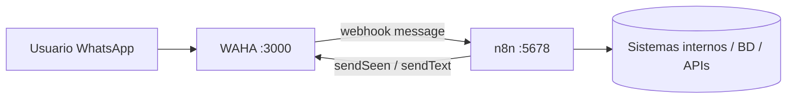
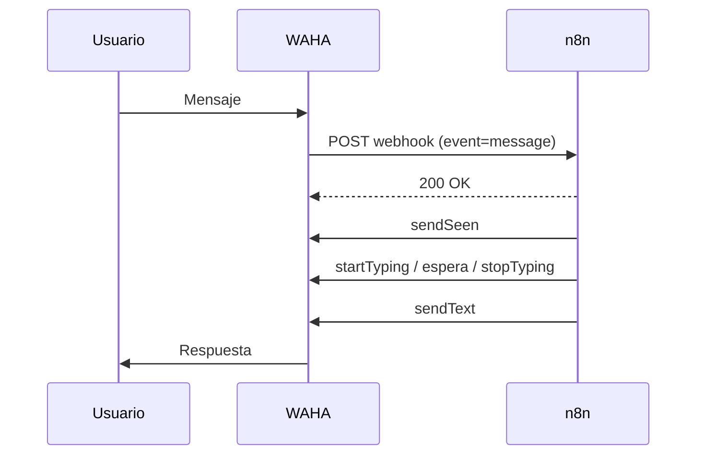

# WAHA + n8n

Fuentes: [guía oficial](https://waha.devlike.pro/blog/waha-n8n/), [integración n8n](https://waha.devlike.pro/docs/integrations/n8n/), [repo del nodo](https://github.com/devlikeapro/n8n-nodes-waha).

## Dos formas de conectarlos
### A. Nodo comunitario de WAHA (recomendada por el proyecto)
1. Levantar WAHA + n8n con Docker Compose (WAHA en el puerto 3000, n8n en 5678). Imagen `devlikeapro/waha` (Core) o `devlikeapro/waha-plus`.
2. En n8n: *Settings → Community nodes* e instalar `@devlikeapro/n8n-nodes-waha`.
3. Crear la credencial **WAHA API**: Host URL `http://waha:3000` (nombre del servicio en la red Docker) o tu dominio; API Key la definida en el compose (`<API-KEY>`).
   - Problema conocido: si no deja guardar, poner cualquier texto en el campo API Key.
4. Crear workflow con **WAHA Trigger** + acción *Send a text message* (conectada a la salida `message`). Guardar y **activar**.
5. Copiar la **Production URL** del WAHA Trigger y usarla como URL de webhook de la sesión en el dashboard de WAHA. Escanear el QR hasta `WORKING`.
6. Probar mandando un mensaje al número.

### B. Webhook genérico de n8n
1. En n8n: nodo **Webhook** (POST, path propio) y activar el workflow.
2. En WAHA: `WHATSAPP_HOOK_URL=<Production URL>` y `WHATSAPP_HOOK_EVENTS=message` (o `config.webhooks` en la sesión).
3. Para responder: nodo **HTTP Request** a `http://waha:3000/api/sendText` con header `X-Api-Key: <API-KEY>` y body `session`, `chatId`, `text`.
4. Opcional: HMAC con **Raw Body** activado (ver [WAHA: webhooks](WAHA-Webhooks.md)).

## Arquitectura

## Flujo de secuencia

## Errores típicos
- **`localhost` en el contenedor:** desde n8n, `localhost:3000` apunta a n8n. Usar `http://waha:3000`.
- **Workflow sin activar:** la Production URL no responde.
- **Bucle:** el bot responde a sus propios mensajes. Filtrar con `payload.fromMe` / `source`.
- **Sesión no `WORKING`:** revisar el evento `session.status` y los estados en [WAHA](WAHA.md).
- **Sin persistencia:** al recrear el contenedor se pierde el QR; montar volumen de sesiones.
- **Payload distinto al cambiar de motor:** los campos de `_data` cambian.
- **Bloqueo de número:** aplicar el [flujo antibloqueo](WAHA-Seguridad-y-Antibloqueo.md).
- **No confundir** con el nodo nativo *WhatsApp Trigger* de n8n, que es otro producto (según conocimiento general, usa la API oficial de Meta, no WAHA).
- Plantillas de workflows: waha-n8n-templates.devlike.pro (referenciado en la guía oficial, no revisado).

## Relacionado
[n8n: nodo Webhook](n8n-Webhook.md) · [WAHA](WAHA.md) · [Índice](Wiki-WhatsApp-Automatizacion.md)
