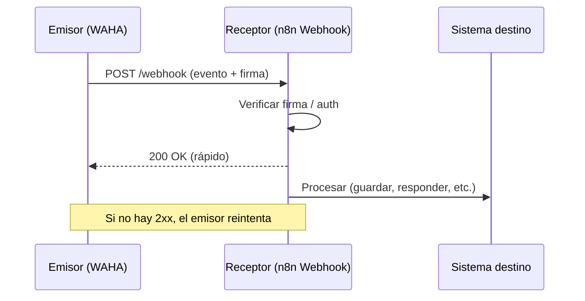

# Webhooks: conceptos

Un **webhook** es una petición HTTP (normalmente `POST` con JSON) que un sistema envía a una URL tuya cuando ocurre un evento. Es lo contrario de hacer polling: en lugar de preguntar, te avisan.

> Nota: esta página es conocimiento general. Los detalles de cada producto están en [WAHA: webhooks](WAHA-Webhooks.md) y [n8n: nodo Webhook](n8n-Webhook.md).

## Piezas
- **Emisor:** quien dispara el evento (ej. WAHA al recibir un mensaje).
- **Receptor / endpoint:** tu URL (ej. el nodo Webhook de n8n).
- **Payload:** el cuerpo con los datos del evento.
- **Respuesta:** el receptor responde con un `2xx` rápido. Si no, el emisor puede reintentar.

## Buenas prácticas del receptor
1. **Responder rápido** (200) y procesar después; los emisores tienen timeouts.
2. **Ser idempotente:** con reintentos puede llegar el mismo evento dos veces. Usar el id del evento (WAHA manda `X-Webhook-Request-Id` y un `id` en el body) para deduplicar.
3. **Verificar autenticidad:** firma HMAC, header secreto, lista de IPs permitidas o auth básica. Una URL sin protección la puede llamar cualquiera.
4. **Usar HTTPS** hacia el exterior.
5. **No confiar en el payload:** validar campos antes de usarlos.
6. **Guardar el body crudo** si hay que verificar la firma (la firma se calcula sobre el cuerpo sin procesar).

## Diagrama de secuencia

## Depuración
- Probar primero con un receptor temporal (por ejemplo webhook.site) para ver el payload real.
- Ver los logs del emisor y las ejecuciones del receptor.
- Localhost y Docker: dentro de un contenedor, `localhost` es el propio contenedor. Usar el nombre del servicio (`http://waha:3000`).
- Red: si el receptor no recibe nada, revisar firewall y restricciones de red (como las que revisa Pedro).

## Relacionado
- [WAHA: seguridad y antibloqueo](WAHA-Seguridad-y-Antibloqueo.md)
- [Índice de la wiki](Wiki-WhatsApp-Automatizacion.md)
