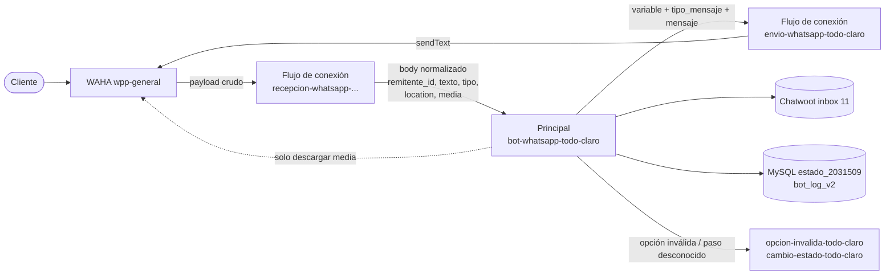

# Comparación: TODO_CLARO (ya en WAHA) vs CLARO_MOVIL (Evolution)

Se tomó `TODO_CLARO Principal V 3.0` como ejemplo de un flujo ya migrado y se comparó con los 5 flujos de CLARO_MOVIL para deducir qué toca cambiar. Documentación del ejemplo: [canvas](TODO_CLARO/TODO-CLARO-Principal.canvas) y [documento](TODO_CLARO/Documentacion-TODO-CLARO-Principal.md). Índice: [Documentación de n8n](Documentacion%20de%20n8n.md).

> **Corrección importante a lo anterior.** La [guía de pruebas](Guia%20de%20pruebas%20CLARO_MOVIL.md), el [pitch](../Pitches/Pitch-Migracion-WAHA-CLARO_MOVIL.md) y el [análisis lógico](Analisis%20logico%20CLARO_MOVIL.md) asumían que la migración era cambiar cada `sendText` de Evolution por `/api/sendText` de WAHA y leer `body.payload…` en el Principal. **El ejemplo migrado no hace eso.** Ahí el Principal no habla con WAHA directo: recibe un cuerpo ya normalizado y envía por un webhook intermedio. Esas secciones deben leerse con esta comparación encima (ver 5).

Los patrones salen de los nodos del propio Principal migrado (qué recibe, a quién llama y con qué cuerpo), ver sección 4.

## 1. Cómo quedó la arquitectura migrada (TODO_CLARO)

Es decir, **tres piezas**: recepción (WAHA → n8n, normaliza), Principal (lógica, igual de "ciega" al proveedor) y envío (n8n → WAHA). Esto es coherente con lo que dijo Sergio: el webhook de WAHA apunta a `recepcion-whatsapp-claro-movil`, que sería la pieza de **recepción**, no el Principal.

## 2. Diferencias lado a lado
| Aspecto | CLARO_MOVIL (hoy, Evolution) | TODO_CLARO (migrado) |
|---|---|---|
| Webhook del Principal | `bot-claro-movil` | `bot-whatsapp-todo-claro` (patrón `bot-whatsapp-<campaña>`) |
| Entrada | Payload crudo de Evolution (`body.data…`) | Cuerpo normalizado por la recepción |
| Teléfono | `body.data.key.remoteJid.split('@')[0]` | `body.remitente_id` |
| Texto | `body.data.message.conversation` / `extendedTextMessage.text` | `body.texto` |
| Tipo de mensaje | Se deduce de la forma del objeto (`locationMessage`…) | `body.tipo`: `location`, `texto`, `audioMessage`, `media` |
| Ubicación | `locationMessage.degreesLatitude/Longitude` | `body.location.latitude/longitude/live` |
| Imagen | Se registra como "[Ubicación enviada]" y cuenta como error | Rama `media`: descarga desde WAHA (`body.media.url` con `X-Api-Key`) y sube como adjunto a Chatwoot |
| Audio | Cuenta como error | Salida `Audio` sin conectar (se ignora) |
| Envío a WhatsApp | `POST {url_evolution}/message/sendText/{session}` con `apikey` | `POST n8n-general/webhook/envio-whatsapp-todo-claro` con `{variable, tipo_mensaje: "texto", mensaje}` |
| `variable` | — | `Variables del menú` completo (`toJsonString()`) |
| Variables del menú | `url_evolution`, `api_evolution`, `session` | `integracion: "WAHA"`, `url_wp` (`wpp-general`), `api_wp`, `session_wp`, `payload`, `inbox_id` |
| Chatwoot | `botconnect.interactivo.com.co:8443` | `chatwoot-general.interactivo.com.co` (coincide con el Excel) |
| Inbox | 13 | 11 |
| Tabla de estado | `claro_movil` | `estado_2031509` (cada campaña tiene la suya; **no forma parte de la migración**) |
| Log | No existe | `bot_log_v2` (payload crudo por interacción) |
| Menú | Texto SI/NO con regex | Opciones numéricas "1 / 2" validadas con igualdad exacta |
| Guardado de estado | Un solo UPSERT genérico (`Consolidar` → `Guardar estado`) | Un UPDATE por transición, cada uno con su traza |
| Llamada a sub-flujos | Body armado a mano (`cliente`, `url_evolution`, `api_evolution`, `session`…) | Body = `Variables del menú` completo |
| Mensajes con asesor | Flujo Relay aparte | Además el Principal registra el mensaje del cliente en Chatwoot en los pasos -1 y 3 |

## 3. Qué toca migrar en CLARO_MOVIL (deducción)
### 01 Principal V3
| Qué | Dónde | Cambio según el patrón migrado |
|---|---|---|
| Ruta de entrada | Webhook entrada | `bot-whatsapp-claro-movil` (por el nombre del patrón; **confirmar**). El path `recepcion-whatsapp-claro-movil` sería el flujo de conexión, no este |
| Teléfono | ~12 nodos (Obtener estado, GET CONTACT, Crea Contacto, Crear Conversación, Ctx inicial, Consolidar, Llamar opción inválida, Normalizar ubicación…) | `remoteJid.split('@')[0]` → `body.remitente_id` |
| Texto | Registrar entrante ×2, ¿Dijo SI?, ¿SI o NO?, Validar opción, Switch Opción, Validar plan, ¿Habeas válido?, ¿Aceptó habeas? | `conversation` / `extendedTextMessage.text` → `body.texto` |
| Tipo de mensaje | Es ubicacion? | Reemplazar por un Switch por `body.tipo` (location / texto / audio / media) |
| Ubicación | Normalizar ubicacion | Leer `body.location.latitude/longitude/live` |
| Imágenes | (no existe) | Añadir la rama media (descarga + adjunto en Chatwoot) |
| Anti-eco | Es texto entrante? | En el ejemplo se conserva un IF sobre `fromMe` (todavía en formato Evolution). **Verificar** si la recepción ya lo filtra |
| Envío | Enviar WhatsApp, Bienvenida WhatsApp, Error ubicacion (3) | Cada uno → POST a `envio-whatsapp-claro-movil` con `{variable, tipo_mensaje:'texto', mensaje}` |
| Variables | Variables del menú, Variables ubicacion, Variables globales | Quitar `url_evolution/api_evolution/session`; poner `integracion`, `url_wp`, `api_wp`, `session_wp`, `payload`; Chatwoot a `chatwoot-general`; `inbox_id` 13 |
| Sub-flujos | Llamar opción inválida, Validacion error1 | Body = `Variables del menú` completo |
| Estado | Guardar estado inicial / Guardar estado | Sin cambio: sigue `claro_movil`. Solo cambia de dónde salen el teléfono (`remitente_id`) y el texto (`texto`) |

### 02 Webhook Chatwoot (relay)
- `Enviar Texto WhatsApp` → POST a `envio-whatsapp-claro-movil`. Como lo dispara Chatwoot (no WAHA), hay que **armar `variable`** a mano: `url_wp`, `api_wp`, `session_wp` y `payload.remitente_id` (= `contact_inbox.source_id`).
- El nodo `Variables`: mismos cambios que en Principal.

### 03 Opción inválida
- Webhook: recibe ahora `Variables del menú` completo (el cliente sale de `body.payload.remitente_id`, no de `body.cliente`). Reescribir las lecturas de `body.cliente`, `body.session`, `body.url_chatwoot`, `body.api_chatwoot`…
- Los 7 `sendText` (Menú 1–5 WhatsApp, Cierre WhatsApp, Aviso WhatsApp) → POST a `envio-whatsapp-claro-movil`.
- `Activar inactividad` sigue sin destino real (ver [análisis](Analisis%20logico%20CLARO_MOVIL.md), H12).

### 04 Inactividad
- `Variables` y `Enviar WhatsApp` (1 `sendText`) → patrón de envío. La sesión por cliente sale de `session_wpp` de la tabla; con el patrón nuevo se manda como `session_wp` en `variable`.
- Si cambia la tabla de estado, cambian las dos consultas del flujo.

### 05 Cambio de estado
- No envía a WhatsApp. Solo: nombre del webhook si cambia el patrón, y la tabla si cambia. Recibirá también `Variables del menú` desde el Principal.

### Resumen
| Cambio | Nodos | Flujos |
|---|---|---|
| `sendText` → webhook de envío | 12 | 01 (3), 02 (1), 03 (7), 04 (1) |
| `remoteJid` → `remitente_id` | ~12 | 01 |
| `conversation` → `texto` | ~10 | 01 |
| Variables Evolution → WAHA/Chatwoot nuevo | 6 nodos Set | 01, 02, 04 |
| Contrato de sub-flujos | 2 llamadas + lecturas | 01 → 03, 05 |
| Rama de media y tipo de mensaje | nuevas | 01 |

## 4. Contrato que confirma el propio Principal
El Principal de TODO_CLARO alcanza para fijar los patrones; no hace falta ver los otros flujos. Lo que se lee de sus nodos:

**Lo que entrega la recepción al Principal** (cuerpo del webhook):
| Campo | Uso en el Principal |
|---|---|
| `remitente_id` | Teléfono del cliente: consultas a la BD, búsqueda/creación de contacto en Chatwoot, `source_id` |
| `texto` | Respuesta del cliente: validaciones (`['1','2']`, `'1'`…), Switch de opciones, registro en Chatwoot |
| `tipo` | `location` / `texto` / `audioMessage` / `media`: decide la rama |
| `location` | `latitude`, `longitude`, `live` |
| `media.url` | URL de la imagen para descargarla (se cambia el dominio de Chatwoot por `wpp-general` y se usa `X-Api-Key`) |
| `data.key.fromMe` | Lo lee `If2` (ruta de Evolution que se mantiene) |

**Lo que recibe el flujo de envío** (se ve en los 6 nodos `HTTP Request4/5/6/10/11/12`): `POST https://n8n-general.interactivo.com.co/webhook/envio-whatsapp-<campaña>` con
```json
{ "variable": <Variables del menú.toJsonString()>, "tipo_mensaje": "texto", "mensaje": "<texto>" }
```
y `variable` trae: `integracion` (WAHA), `tipo`, `payload` (el cuerpo recibido, de ahí sale `remitente_id`), `estado_actual`, `id_cuenta`, `id_conversacion`, `etiqueta_chatwoot`, `api_chatwoot`, `url_chatwoot`, `api_wp`, `url_wp`, `session_wp`, `inbox_id`.

**Lo que reciben los sub-flujos** (`Validacion error` y `Validacion error1`): el mismo `Variables del menú` completo como body.

**Valores de CLARO_MOVIL** que ya se tienen:
| Variable | Valor |
|---|---|
| `url_wp` | `https://wpp-general.interactivo.com.co` |
| `session_wp` | `AGENTE_PRUEBA_1` |
| `url_chatwoot` | `https://chatwoot-general.interactivo.com.co` |
| `inbox_id` | `13` |
| Webhook del Principal | `bot-whatsapp-claro-movil` (patrón `bot-whatsapp-<campaña>`) |
| Envío | `envio-whatsapp-claro-movil` (patrón `envio-whatsapp-<campaña>`) |
| `api_wp` | la clave de WAHA, que está en el Excel de inventario |

**Fuera de alcance, por decisión tuya:** tablas y código analítico. No se tocan ni se preguntan: CLARO_MOVIL sigue con su tabla `claro_movil` y la migración solo cambia de dónde se lee el mensaje, cómo se envía y qué variables se usan.

## 5. Qué cambia respecto a lo que ya estaba documentado
| Documento | Qué ajustar |
|---|---|
| [Guía de pruebas](Guia%20de%20pruebas%20CLARO_MOVIL.md) | Los pasos 3–4 (probar `/api/sendText` y capturar payload de WAHA) siguen sirviendo, pero el payload crudo lo ve el **flujo de recepción**; el Principal recibe el cuerpo normalizado. El path del Principal no es `recepcion-…`. |
| [Pitch](../Pitches/Pitch-Migracion-WAHA-CLARO_MOVIL.md) | "Elementos clave" 1–4 y el rabbit hole del `@lid`: el teléfono lo resuelve la recepción (`remitente_id`). El cambio de envío es al webhook intermedio. Dos preguntas abiertas se resuelven por deducción (ruta y URL de WAHA/Chatwoot). |
| [Análisis lógico](Analisis%20logico%20CLARO_MOVIL.md) | H1/H2 (regex SI/NO): el ejemplo las evita con opciones "1/2" por igualdad exacta. H3 y H4 desaparecen con `body.texto` y `body.tipo`. |
| [Documentación de n8n](Documentacion%20de%20n8n.md) | Dominios: el ejemplo usa a la vez `2031510-n8n` (sub-flujos) y `n8n-general` (envío). No es un error de CLARO_MOVIL: conviven. |

## 6. No copiar tal cual: defectos del flujo "ya migrado"
- **Restos de Evolution sin conectar:** 8 nodos huérfanos (5 `sendText` directos, `Obtener Base64 Imagen`, `Variables imagen`, `Convert to File`); además la salida `Audio` del `Switch2` no va a ningún nodo. Siguen con una clave de Evolution escrita.
- **`If2` lee `body.data.key.fromMe`**, ruta de Evolution, aunque el cuerpo ya es normalizado: o la recepción lo conserva, o el filtro nunca bloquea.
- **`session_wpp` queda mal:** los UPDATE usan `Variables del menú.session`, que ese nodo no define (define `session_wp`), y el INSERT usa `Variables globales.session = "CLARO_MOVIL"`, copiado de otro flujo.
- **Chatwoot en dos URLs:** `Variables del menú` usa `chatwoot-general`, pero `Ubicacion a Chatwoot1` y `Enviar Imagen Chatwoot` siguen escritos con `botconnect…:8443`.
- **Cableado dudoso:** en paso `-1` la respuesta "1–5" (categoría) entra a la cadena que guarda `telefono = texto` y crea el lead en la CTI; ahí el "teléfono" sería el número de la categoría. Verificar si es intencional.
- **Claves escritas en nodos:** Chatwoot, WAHA y usuario/clave de la plataforma E2E/CTI (nodo `HTTP Request2`). No se copiaron a estas notas.
- **Heredado sin corregir:** `Filtro Inbox 11` compara una constante con otra (siempre verdadero); `Asignar a asesor3` reemplaza etiquetas; la carga de asesores filtra por `asignado-asesor` mientras la etiqueta que se pone es `agente_terminales`; si no hay agentes online el flujo termina sin asignar.

## 7. Resumen de lo que toca
1. Principal: entrada con el cuerpo normalizado (`remitente_id`, `texto`, `tipo`, `location`, `media`), Switch por `tipo`, rama de imagen y path `bot-whatsapp-claro-movil`.
2. Reemplazar los 12 `sendText` por el POST a `envio-whatsapp-claro-movil` con `{variable, tipo_mensaje, mensaje}`.
3. Variables: quitar `url_evolution`/`api_evolution`/`session`; poner `integracion`, `url_wp`, `api_wp`, `session_wp`, `payload`, Chatwoot nuevo, `inbox_id`.
4. Sub-flujos 03, 04, 05 y relay 02: leer `Variables del menú` como body y enviar por el mismo webhook de envío.
5. Actualizar el pitch y la guía de pruebas con esto.


Volver a [Documentación de n8n](Documentacion%20de%20n8n.md) · [Home](../Home.md)
