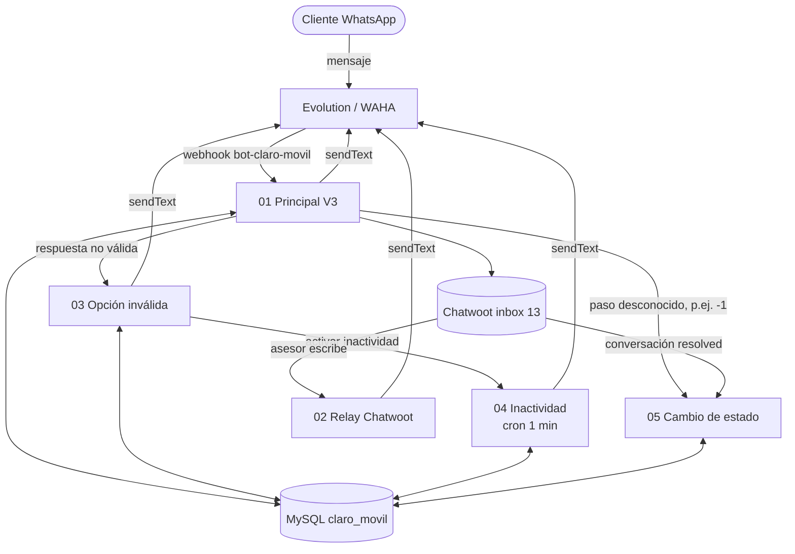

# Documentación de n8n: CLARO_MOVIL

Documentación de los 5 workflows de la carpeta **CLARO_MOVIL** en n8n (bot de WhatsApp de Claro Móvil, línea 3014048151, hoy sobre Evolution y en migración a WAHA). Sale de los JSON exportados en `n8n-json/`; **los flujos no se modifican**, esto es solo documentación.

Contexto de la tarea: [Contexto migración WAHA](../Projects/Contexto-Migracion-WAHA-CLARO_MOVIL.md) · Seguimiento: [Migración WAHA: CLARO_MOVIL](../Projects/Migracion-WAHA-CLARO_MOVIL.md) · Resumen previo: [Flujos n8n](../Projects/CLARO_MOVIL-Flujos-n8n.md).

Para probar la copia en n8n: [Guía de pruebas CLARO_MOVIL](Guia%20de%20pruebas%20CLARO_MOVIL.md).

Revisión lógica (tablas de verdad, errores y optimizaciones): [Análisis lógico](Analisis%20logico%20CLARO_MOVIL.md).

Datos recibidos, equivalencias y dónde tocar: [Datos y equivalencias WAHA](Datos%20y%20equivalencias%20WAHA.md).

Flujo de referencia ya migrado: [TODO_CLARO Principal V 3.0](TODO_CLARO/Documentacion-TODO-CLARO-Principal.md) ([canvas](TODO_CLARO/TODO-CLARO-Principal.canvas)) y la [comparación con CLARO_MOVIL](Comparacion%20TODO_CLARO%20vs%20CLARO_MOVIL.md), que dice qué toca migrar.

## Los 5 flujos
| # | Flujo | Disparador | Canvas | Documento | Nodos |
|---|---|---|---|---|---|
| 01 | Principal V3 | Webhook `bot-claro-movil` | [Principal-V3.canvas](CLARO_MOVIL/Principal-V3.canvas) | [Documentación](CLARO_MOVIL/Documentacion-Principal-V3.md) | 61 |
| 02 | Webhook Chatwoot (relay) | Webhook `chatwoot-claro-movil` | [Relay-Chatwoot.canvas](CLARO_MOVIL/Relay-Chatwoot.canvas) | [Documentación](CLARO_MOVIL/Documentacion-Relay-Chatwoot.md) | 7 |
| 03 | Opción inválida | Webhook `opcion-invalida-claro-movil` | [Opcion-Invalida.canvas](CLARO_MOVIL/Opcion-Invalida.canvas) | [Documentación](CLARO_MOVIL/Documentacion-Opcion-Invalida.md) | 23 |
| 04 | Inactividad | Cron cada 1 min | [Inactividad.canvas](CLARO_MOVIL/Inactividad.canvas) | [Documentación](CLARO_MOVIL/Documentacion-Inactividad.md) | 11 |
| 05 | Cambio de estado de conversación | Webhook `cambio-estado-conversacion-claro-movil` | [Cambio-Estado-Conversacion.canvas](CLARO_MOVIL/Cambio-Estado-Conversacion.canvas) | [Documentación](CLARO_MOVIL/Documentacion-Cambio-Estado-Conversacion.md) | 5 |

Cada canvas tiene una tarjeta por nodo (nombre, tipo, qué hace, variables que lee y que maneja) y marca con ⚠️ lo que hay que cambiar para WAHA. Cada documento trae la misma información en tabla, las conexiones y la lista de intervención.

## Cómo se conectan

## Ciclo de una conversación
1. El cliente escribe → **Principal** crea/reutiliza contacto y conversación en Chatwoot, guarda `paso = 1` y envía la bienvenida.
2. Cada respuesta pasa por la máquina de estados (tabla de abajo). Una respuesta no válida llama a **Opción inválida** (reenvía el menú; al 3.º error cierra).
3. Si el cliente se queda callado, **Inactividad** envía hasta 2 recordatorios y al 3.º cierra.
4. En un traspaso (`paso = -1`) el flujo asigna al asesor menos cargado y desde ahí **Relay** lleva al cliente lo que el asesor escriba.
5. Al resolver la conversación en Chatwoot, **Cambio de estado** deja `paso = 1000` y el siguiente mensaje arranca de cero.

## Máquina de estados (`claro_movil.paso`)
| paso | Significado | Qué espera | Si responde bien | Si responde mal |
|---|---|---|---|---|
| 0 / 1000 | Sin conversación o cerrada | Cualquier mensaje | Crea conversación, envía bienvenida → 1 | — |
| 1 | Bienvenida enviada | SI | Menú de 5 opciones → 2 | Opción inválida |
| 2 | Menú 1–5 | 1 a 5 | 1 deuda → 1000; 2 y 3 habeas → 5; 4 ofertas → 4; 5 *611 → 1000 | Opción inválida |
| 3 | ¿El número a portar recibe llamadas? | SI/NO | Migración (handoff) → -1 | Opción inválida |
| 4 | Ofertas | 1 a 4 | Plan → asesor (handoff) → -1 | Opción inválida |
| 5 | Habeas data | SI/NO | SI → pregunta de portabilidad → 3; NO → rechazo → 1000 | Opción inválida |
| -1 | Atendido por asesor | Humano | Relay reenvía al cliente | — |

Etiquetas de Chatwoot que asigna: `claro-terminales`, `claro-migracion`, `claro-portabilidad`. Handoff: asigna al agente **online** con menos conversaciones abiertas con etiqueta `asignado-asesor`.

## Tabla `claro_movil` (MySQL)
| Columna | Uso |
|---|---|
| `cliente` | Teléfono del cliente (sin `@…`) |
| `tipo` | Siempre `CLARO_MOVIL` |
| `id_cuenta` | Cuenta de Chatwoot (`1`) |
| `id_inbox` | Inbox de Chatwoot (`13`) |
| `id_conversacion` | Conversación abierta en Chatwoot |
| `paso` | Estado actual (ver máquina de estados) |
| `num_advertencia` | Recordatorios de inactividad enviados (0–3) |
| `num_errores` | Respuestas no válidas seguidas (cierra al 3.º) |
| `session_wpp` | Sesión de WhatsApp con la que se atiende (hoy `AGENTE_PRUEBA_1`) |
| `etiqueta_chatwoot` | Última etiqueta aplicada |
| `ori_fields` | JSON de trazabilidad (eventos de ubicación) |
| `fecha_modificacion` | Última actividad; base de la inactividad |

Clave lógica: (`cliente`, `tipo`). Principal usa `ON DUPLICATE KEY UPDATE`.

## Variables que se repiten en los flujos
| Variable | Valor / origen | Dónde |
|---|---|---|
| `tipo` | `CLARO_MOVIL` | Todos |
| `id_cuenta` | `1` | Principal, Inactividad, Opción inválida |
| `inbox_id` | `13` | Principal, Relay, Inactividad, Cambio de estado |
| `url_chatwoot` | `https://botconnect.interactivo.com.co:8443` | Todos los que hablan con Chatwoot |
| `api_chatwoot` | clave en el nodo Set (no se copia aquí) | Ídem |
| `url_evolution` | `https://evolution-general.interactivo.com.co` | Nodos Set de Principal, Relay e Inactividad; se pasa a Opción inválida |
| `api_evolution` | clave en el nodo Set (no se copia aquí) | Ídem |
| `session` | `AGENTE_PRUEBA_1` | Nodos Set; también `session_wpp` en BD |
| `url_n8n` | `https://2031510-n8n.interactivo.com.co` | Variables del menú de Principal |
| `estado_actual` | `paso` de MySQL (por defecto `0`) | Variables del menú, Relay |

⚠️ Las claves de Chatwoot y Evolution están escritas dentro de los nodos `Set` de los JSON (y Principal las manda en el body a Opción inválida). Los JSON de `n8n-json/` están en esta bóveda con git: no subirlos tal cual a un repositorio compartido.

## Webhooks y URLs de entrada
| Quién llama | Ruta | Flujo |
|---|---|---|
| Evolution (hoy) / WAHA (destino) | `/webhook/bot-claro-movil` | 01 Principal |
| WAHA (según Sergio) | `/webhook/recepcion-whatsapp-claro-movil` | **No existe aún en los flujos exportados** |
| Chatwoot | `/webhook/chatwoot-claro-movil` | 02 Relay |
| Principal | `/webhook/opcion-invalida-claro-movil` | 03 Opción inválida |
| Opción inválida | `/webhook/inactividad-claro-movil` | Ninguno (04 no tiene webhook, solo cron) |
| Chatwoot / Principal | `/webhook/cambio-estado-conversacion-claro-movil` | 05 Cambio de estado |

## Integraciones externas
| Servicio | Para qué | Flujos |
|---|---|---|
| Evolution / WAHA | Enviar y recibir WhatsApp | 01, 02, 03, 04 |
| Chatwoot (inbox 13) | Contactos, conversaciones, mensajes, etiquetas, asignaciones, cierre | 01, 02, 03, 04, 05 |
| MySQL `claro_movil` | Estado del cliente | 01, 02, 03, 04, 05 |
| Nominatim (OpenStreetMap) | Convertir lat/lng a departamento y municipio | 01 |

## Migración a WAHA: qué hay que intervenir
Detalle por nodo en la sección "Intervención para WAHA" de cada documento y con ⚠️ en cada canvas.

| Cambio | Flujos |
|---|---|
| Leer el mensaje del formato WAHA (`body.payload.from`, `body.payload.body`, `payload.fromMe`, `payload.location`) | 01 |
| Ruta del webhook de entrada a `recepcion-whatsapp-claro-movil` | 01 |
| Envío: `/api/sendText`, header `X-Api-Key`, body con `chatId` (`@c.us`) y `session` | 01 (3 nodos), 02 (1), 03 (7), 04 (1) |
| Variables `url_evolution` / `api_evolution` → URL y clave de WAHA | 01, 02, 04 (y se pasan a 03) |
| Confirmar dominio n8n vigente (`2031510-n8n…` vs `n8n-general…`) | 01, 03 |
| Sin cambios | 05, y todos los nodos de Chatwoot y MySQL salvo los que leen el teléfono del payload |

Por validar con un payload real de WAHA: ruta exacta del teléfono (`from` puede venir `@lid` según el motor) y la forma de `location`.

## Preguntas abiertas
- ¿Qué ruta de entrada queda: `bot-claro-movil` o `recepcion-whatsapp-claro-movil`?
- ¿Cuál es la URL real de Chatwoot: `botconnect…:8443` (flujos) o `chatwoot-general…` (Excel)?

Volver a [Home](../Home.md)
